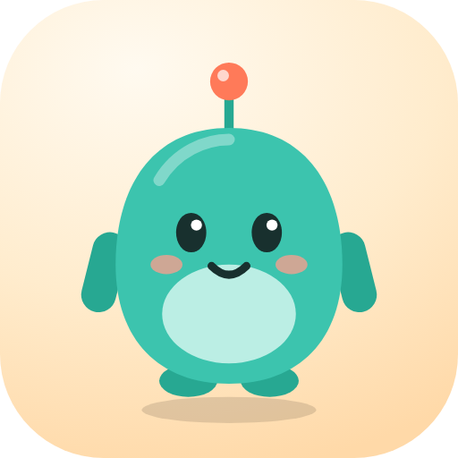
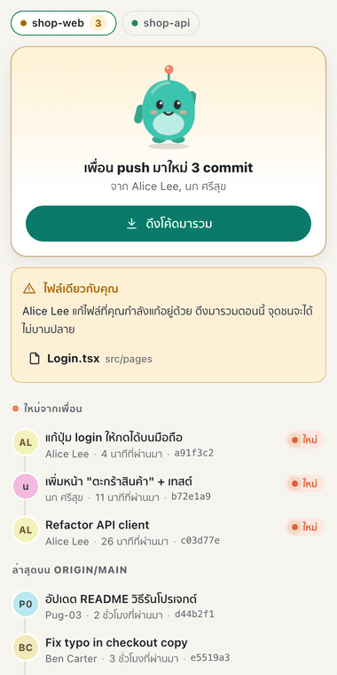
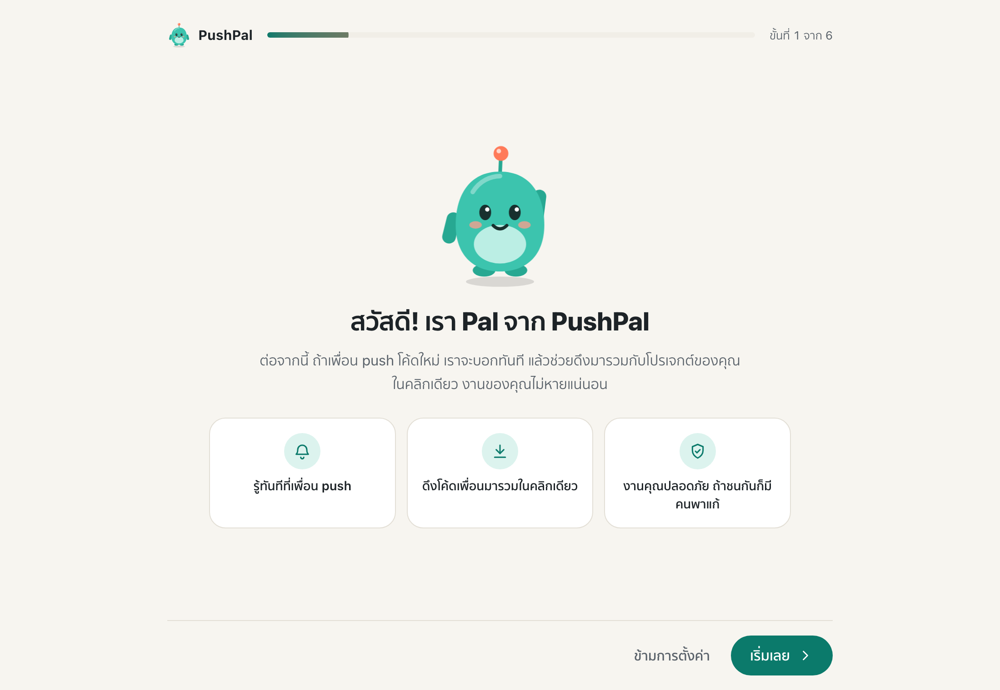
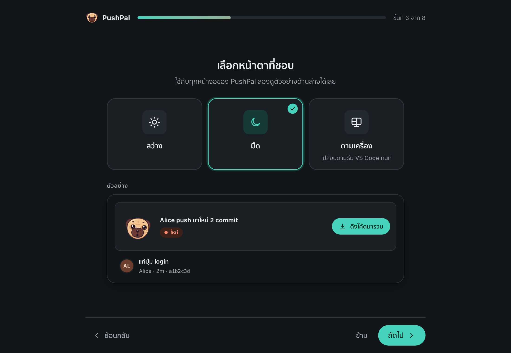
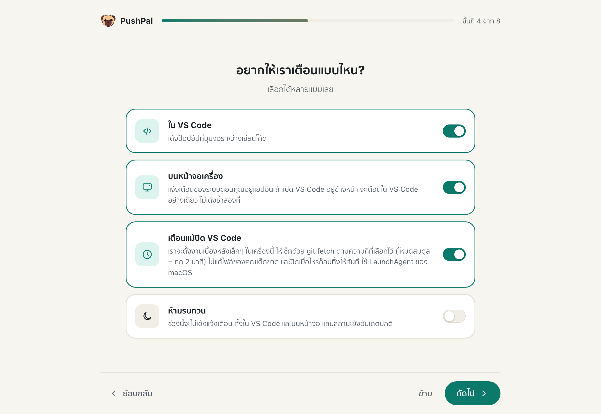
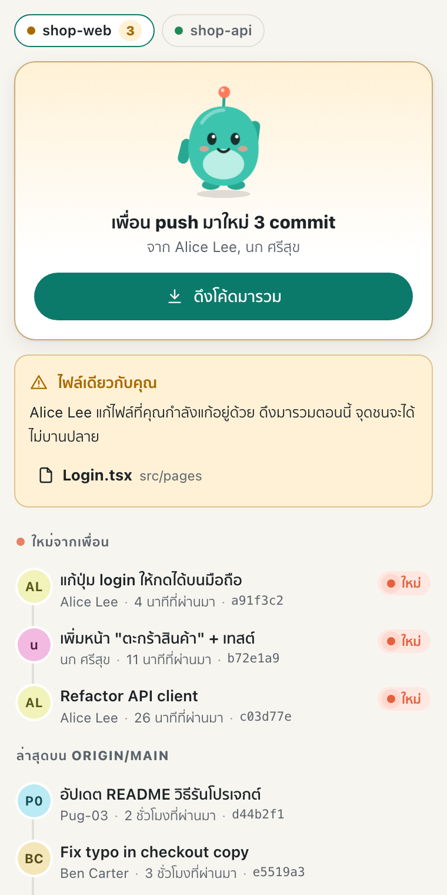
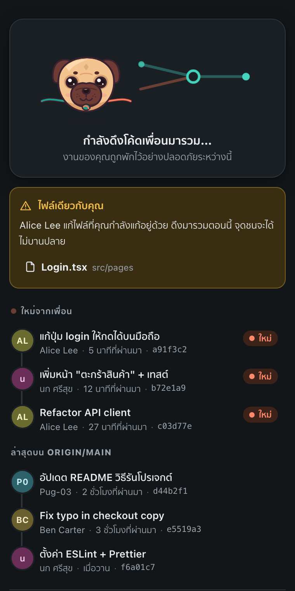
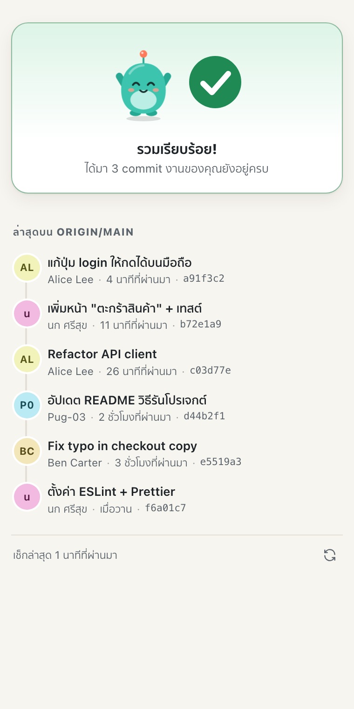
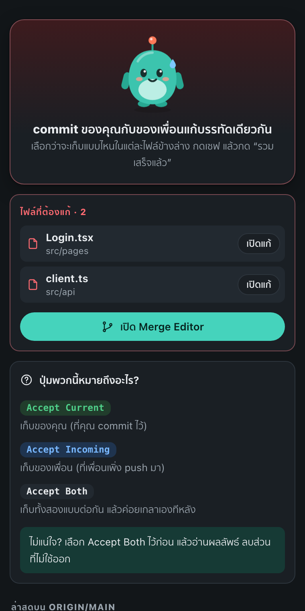

<p align="center">
  
</p>

<h1 align="center">PushPal</h1>

<p align="center">
  <b>รู้ทันทีที่เพื่อน push · ดึงโค้ดมารวมในคลิกเดียว · งานคุณไม่หาย</b><br>
  Know the moment a teammate pushes · pull their code in with one click · never lose your work
</p>

<p align="center">
  <a href="#ภาษาไทย">ภาษาไทย</a> · <a href="#english">English</a>
</p>

<p align="center">
  
</p>

---

## ภาษาไทย

### ปัญหาที่ PushPal แก้

ทำงานกับเพื่อนผ่าน GitHub แล้วเพื่อน push โค้ดใหม่ แต่เราไม่รู้ ทำต่อบนโค้ดเก่าไปเรื่อยๆ
พอจะ push ก็ชนกันเละ — PushPal เตือนทันทีที่เพื่อน push (แม้ปิด VS Code อยู่ก็ได้)
แล้วดึงโค้ดมารวมให้ในคลิกเดียว โดยงานที่ยังไม่ commit ของคุณไม่หาย

### ฟีเจอร์

- **เช็กให้อัตโนมัติ** ทุก 60 วินาที (ตั้งได้) และทุกครั้งที่สลับกลับมา VS Code
- **แจ้งเตือนครั้งเดียวต่อ commit ใหม่** บอกว่าใคร push, กี่ commit, ข้อความล่าสุด, เมื่อไหร่
- **เตือนพิเศษเมื่อเพื่อนแก้ไฟล์เดียวกับคุณ** (ทั้งที่ยังไม่ commit, commit แล้วยังไม่ push และไฟล์ใหม่)
- **ปุ่ม “ดึงโค้ดมารวม”** — ใช้ `git pull --no-rebase --autostash --no-edit` งานที่ยังไม่ commit ถูกพักไว้แล้วคืนให้เอง
- **ถ้าชนกัน** บอกไฟล์ที่ชน เปิดไฟล์ให้ พาไป Merge Editor และอธิบายว่า Accept Current / Incoming / Both คืออะไร
  (แยกกรณี “ชนกับ commit ของคุณ” และ “ชนกับงานที่ยังไม่ commit” ให้ถูก และเก็บกวาด stash สำรองให้อัตโนมัติ)
- **ไม่ดึงซ้ำ** ถ้ายังมีจุดชนค้างจากรอบก่อน
- **แถบสถานะ 4 แบบ**: โค้ดล่าสุดแล้ว / เพื่อน push มาใหม่ N (เหลือง คลิกเพื่อดึง) / มีจุดชนรอแก้ (แดง) / เช็กไม่ได้
- **แจ้งเตือนบนหน้าจอเครื่อง** — macOS (alerter มีปุ่ม), Windows (toast มีปุ่ม ไม่ต้องลงอะไร), Linux (notify-send)
- **เตือนแม้ปิด VS Code** (เลือกเปิดเอง) — ใช้ LaunchAgent / Task Scheduler ทำแค่ `git fetch` ไม่แก้ไฟล์
- **หน้า “ทีมของฉัน”** ไทม์ไลน์ commit ของเพื่อน พร้อม Pal มาสคอตหน้ากลมที่เปลี่ยนสีหน้าตามสถานะ (คิ้ว ตา ปาก แก้ม)
  กดจิ้มเล่นได้ — ยุบ เด้ง หัวเราะ และถ้าจิ้มรัวๆ จะตาลาย
- **ภาษาไทย / English** และ **ธีมสว่าง / มืด / ตามเครื่อง**
- หลาย repo ใน workspace เดียว, repo ที่ยังไม่มี upstream ก็รองรับ
- **ไม่มี telemetry** ไม่ส่งข้อมูลออกนอกเครื่องนอกจาก `git fetch` / `git pull` ปกติ

### ภาพหน้าจอ

| ตั้งค่าครั้งแรก | เลือกธีม (พรีวิวสด) | วิธีเตือน |
|---|---|---|
|  |  |  |

| เพื่อน push มาใหม่ | กำลังดึง | รวมเรียบร้อย | เจอจุดชน |
|---|---|---|---|
|  |  |  |  |

ภาพทั้งหมด (โหมดมืดและสว่าง) อยู่ใน [`docs/screenshots/`](docs/screenshots)

### ติดตั้ง

- **จาก Marketplace**: ค้นหา “PushPal” ในแถบ Extensions ของ VS Code แล้วกด Install
- **จากไฟล์ .vsix**: ดาวน์โหลด `pushpal-x.y.z.vsix` จากหน้า Releases บน GitHub
  แล้วใน VS Code กด `⇧⌘P` / `Ctrl+Shift+P` → **Extensions: Install from VSIX…** → เลือกไฟล์

ติดตั้งจาก Marketplace แล้ว **อัปเดตเองอัตโนมัติ** ไม่ต้องทำอะไร (ถ้าปิด auto-update ไว้ จะมีปุ่ม **Update** ในแถบ Extensions)
ส่วนแบบ .vsix ต้องดาวน์โหลดไฟล์ใหม่มาติดตั้งทับเอง

ติดตั้งเสร็จ หน้าตั้งค่าจะเปิดขึ้นมาเอง 6 ขั้นสั้นๆ (เปิดซ้ำได้ด้วยคำสั่ง **PushPal: ตั้งค่าใหม่**)

### วิธีใช้

1. เปิดโฟลเดอร์โปรเจกต์ที่ใช้ git (ที่ clone มาจาก GitHub)
2. ดูแถบสถานะมุมซ้ายล่าง ถ้าเป็นสีเหลือง = เพื่อน push มาใหม่ → คลิกเพื่อดึงโค้ดมารวม
3. กดรูป Pal บนแถบซ้ายเพื่อเปิดหน้า **ทีมของฉัน**
4. ถ้าชนกัน: แก้ทีละไฟล์ใน Merge Editor → เซฟ → กด **รวมเสร็จแล้ว** (หรือ stage ไฟล์ ถ้าเป็นงานที่ยังไม่ commit)

### การตั้งค่า

| Setting | ค่าเริ่มต้น | ความหมาย |
|---|---|---|
| `pushpal.language` | `auto` | `auto` / `th` / `en` |
| `pushpal.theme` | `system` | `system` (ตามธีม VS Code) / `light` / `dark` |
| `pushpal.checkIntervalSeconds` | `60` | เช็กทุกกี่วินาที (15–3600) |
| `pushpal.notify.inVSCode` | `true` | เด้งใน VS Code |
| `pushpal.notify.desktop` | `true` | แจ้งเตือนบนหน้าจอเมื่อไม่ได้อยู่ใน VS Code |
| `pushpal.notify.background` | `false` | เช็กแม้ปิด VS Code (macOS / Windows) |
| `pushpal.notify.sameFileWarning` | `true` | เตือนพิเศษเมื่อแก้ไฟล์เดียวกัน |

### คำถามที่พบบ่อย

**งานที่ยังไม่ commit จะหายไหม?**
ไม่หาย PushPal ใช้ `--autostash` git จะพักงานไว้ก่อน แล้วคืนให้หลังรวมเสร็จ ถ้าคืนแล้วชนกัน
งานคุณยังมีสำรองอยู่ใน stash จนกว่าคุณจะแก้และ stage ครบ แล้ว PushPal ค่อยลบตัวสำรองให้

**PushPal จะ pull เองโดยไม่ถามไหม?**
ไม่ PushPal ดึงโค้ดเฉพาะตอนคุณกดปุ่มเท่านั้น งานเบื้องหลังทำแค่ `git fetch` เพื่อดูว่ามีอะไรใหม่

**Mac ไม่มีปุ่มบนแจ้งเตือน?**
ติดตั้ง alerter: `brew install vjeantet/tap/alerter` (หรือกดปุ่มในหน้าตั้งค่า) แล้วตั้ง
System Settings → Notifications → Visual Studio Code / alerter → Alert style: **Persistent**

**macOS เด้งว่า “Background item added”?**
ปกติครับ เกิดตอนเปิด “เตือนแม้ปิด VS Code” เพราะ PushPal ตั้ง LaunchAgent ปิดตัวเลือกนี้เมื่อไหร่ก็ลบออกทันที

**Windows ไม่เห็น toast?**
Settings → System → Notifications → เปิดของ Visual Studio Code (หรือ Windows PowerShell) และปิด Do not disturb

**ถอนส่วนขยายแล้วงานเบื้องหลังยังอยู่ไหม?**
ไม่ VS Code จะเรียกสคริปต์ถอนให้ และตัวงานเบื้องหลังเองก็เช็กทุกครั้ง ถ้าส่วนขยายไม่อยู่แล้วจะลบตัวเองทิ้ง

**ต้องล็อกอิน GitHub ไหม?**
PushPal ใช้ git ตัวเดียวกับที่คุณใช้อยู่ ถ้า `git fetch` ในเครื่องคุณทำงานได้ PushPal ก็ทำงานได้
(ไม่ถามรหัสผ่านเอง ถ้าเข้าไม่ได้จะบอกให้กด Sync ใน Source Control สักครั้ง)

**ส่งข้อมูลอะไรออกไปไหม?**
ไม่มี telemetry ใดๆ ข้อมูลที่ออกจากเครื่องมีแค่ `git fetch` / `git pull` ไปยัง remote ของคุณเอง

---

## English

### The problem

You work with friends on GitHub. A teammate pushes, you don't notice, you keep building on old code,
and when you finally push — conflicts everywhere. **PushPal tells you the moment a teammate pushes**
(even when VS Code is closed, if you want) and **pulls their code in with one click without losing your work**.

### Features

- Checks the remote every 60 s (configurable) and every time you switch back to VS Code (`git fetch`, then `HEAD..@{u}`)
- One notification per new commit: who pushed, how many commits, the latest message, and when
- Extra warning when a teammate changed a file you're also changing (uncommitted, committed-but-unpushed, or new)
- **Pull in changes**: `git pull --no-rebase --autostash --no-edit` — uncommitted work is set aside and restored
- Conflicts: lists the files, opens them, takes you to VS Code's Merge Editor and explains Accept Current / Incoming / Both
  in plain words — correctly for both "conflict with your commits" and "conflict with your uncommitted work";
  the backup stash is dropped automatically once you've staged everything
- Won't pull again while conflicts from last time are still open
- Status bar: up to date / N new from your team (yellow, click to pull) / conflicts to fix (red) / can't check
- Desktop notifications: macOS (alerter with buttons, osascript fallback), Windows (toast with buttons, nothing to install),
  Linux (notify-send). If VS Code is focused you only get the VS Code pop-up, never both.
- Optional checks while VS Code is closed: LaunchAgent (macOS) / Task Scheduler (Windows), `git fetch` only
- “My Team” view: teammates' commit timeline with Pal, a round-faced mascot whose brows, eyes, mouth and cheeks
  change with the state. Poke it: it squishes, bounces, giggles, and gets dizzy if you poke too fast
- Thai / English, Light / Dark / Match VS Code themes, multi-repo workspaces, branches without upstream
- No telemetry. Nothing leaves your machine except your normal `git fetch` / `git pull`

### Install

- **Marketplace**: search “PushPal” in the Extensions view.
- **.vsix**: download it from GitHub Releases, then **Extensions: Install from VSIX…** in the Command Palette.

Marketplace installs update automatically (or show an **Update** button if you turned auto-update off).
A .vsix install doesn't update itself; install the newer file over it.

The setup wizard opens after the first install. Run **PushPal: ตั้งค่าใหม่ · Run Setup Again** to see it again.

### FAQ

- **Will I lose uncommitted work?** No. Git's autostash parks it and restores it; on a conflict a backup stays in the
  stash until you've resolved and staged every file.
- **Does PushPal ever pull on its own?** No. Only when you press the button. The background job only fetches.
- **No buttons on macOS notifications?** `brew install vjeantet/tap/alerter`, then set the alert style to *Persistent*.
- **Uninstalling** removes the background job (uninstall hook + the job removes itself if the extension is gone).

## Development

```bash
npm install
npm test            # real-git tests: bare remote + two clones
npm run build
npm run smoke       # runs the extension in your local VS Code with an isolated profile (macOS)
npm run screenshots # renders every screen into docs/screenshots/
npm run package     # builds pushpal-<version>.vsix
npm run icon        # re-renders media/icon.png from the mascot
```

### Releasing

```bash
npm run release     # bump patch version, tag vX.Y.Z, push
```

Pushing the tag makes CI run the tests, attach the .vsix to a GitHub Release, and publish to the VS Code
Marketplace and Open VSX (when the `VSCE_PAT` / `OVSX_PAT` secrets are set). Users then get the update automatically.
Commit everything (and add a `CHANGELOG.md` entry) first: `npm version` refuses to run on a dirty working tree.

Design decisions are documented in [DECISIONS.md](DECISIONS.md). Publishing steps: [PUBLISHING.md](PUBLISHING.md).

## License

[MIT](LICENSE)
