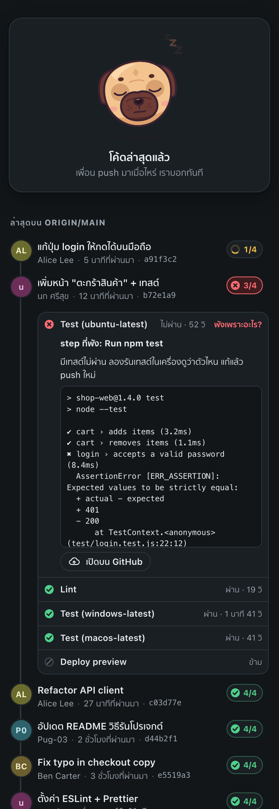
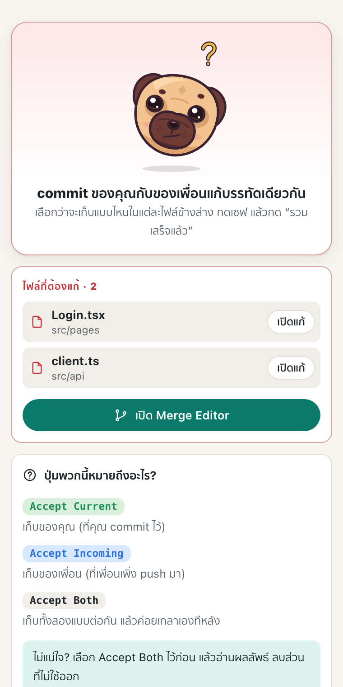
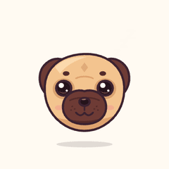
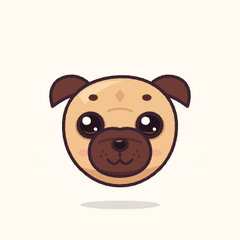
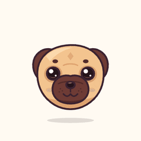
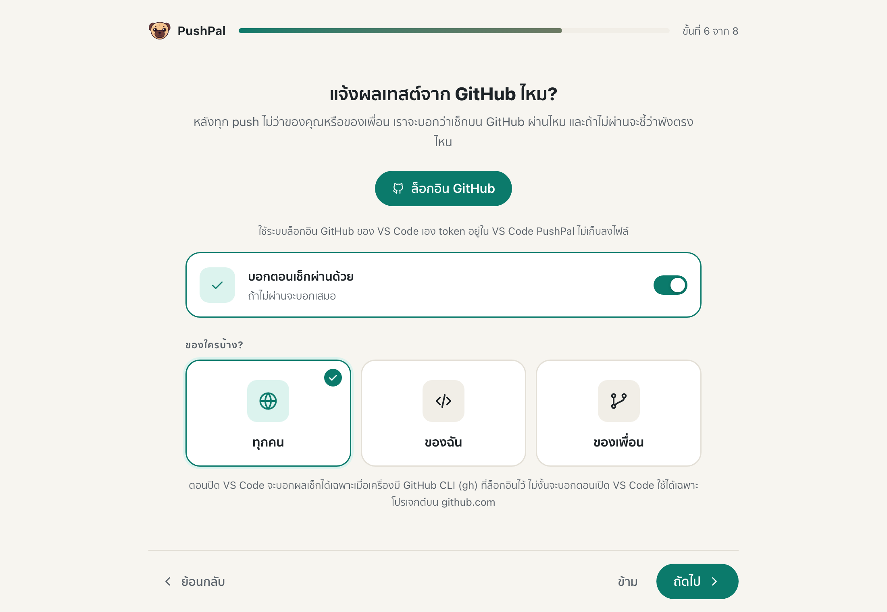
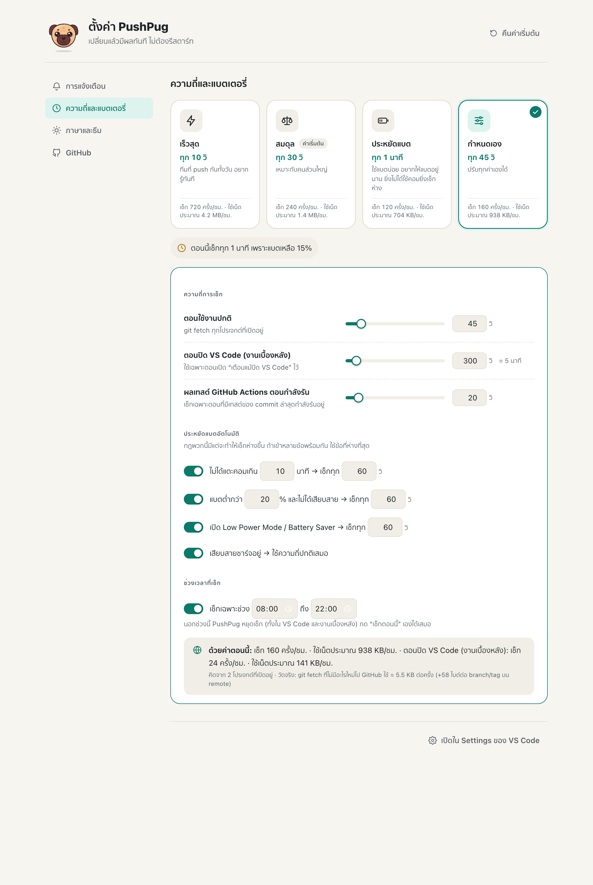
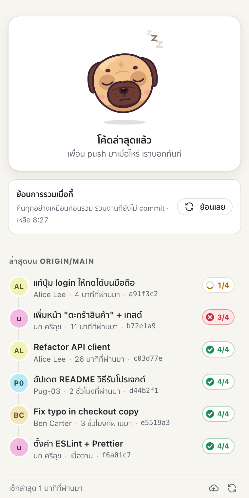

<p align="center">
  
</p>

<h1 align="center">PushPal</h1>

<p align="center">
  <b>Know the moment a teammate pushes. Pull their code in with one click. Never lose your work.</b>
</p>

<p align="center">
  <a href="https://github.com/Pug-03/PushPal/actions/workflows/ci.yml"></a>
  
  
  
</p>

<p align="center">
  
</p>

<p align="center">
  <a href="#why-pushpal">Why</a> ·
  <a href="#features">Features</a> ·
  <a href="#install">Install</a> ·
  <a href="#quick-start">Quick start</a> ·
  <a href="#how-to">How-to</a> ·
  <a href="#settings">Settings</a> ·
  <a href="#privacy">Privacy</a> ·
  <a href="#troubleshooting">Troubleshooting</a>
</p>

---

## Why PushPal

You're building something with friends on GitHub. Someone pushes, you don't notice, you keep working on
old code — and when you finally push, everything conflicts.

PushPal sits quietly in VS Code and watches the remote for you. The moment a teammate pushes, it tells you
who pushed what, warns you if they touched the same file you're editing, and pulls their code in with one
click — with your uncommitted work set aside safely and put back afterwards. When something does conflict,
it walks you through fixing it in plain language.

It's made for people who are new to Git, and for everyone who'd rather not think about it.

## Features

<table>
<tr>
<td width="50%" valign="top">

### 🔔 Know the moment they push
Checks the remote on a schedule and whenever you come back to VS Code. One alert per new push: who, how
many commits, the latest message — as a VS Code pop-up or a desktop notification, never both. Even when
VS Code is closed, if you want.

### ⬇️ Pull in one click, lose nothing
**Pull in changes** merges your teammates' code while your uncommitted work is parked and restored.
Changed your mind? **Undo the last merge** for 10 minutes — everything comes back, uncommitted work
included.

### 🧭 Conflicts, explained
Opens the conflicted files, takes you to the Merge Editor, and explains *Accept Current / Incoming / Both*
for your exact situation. Git errors become plain sentences with the fix, plus *Show full message*.

</td>
<td width="50%" valign="top">

### ✅ GitHub checks for every commit
After every push — yours or a teammate's — PushPal follows the GitHub checks and tells you how it went:
*“❌ Checks failed: 1 of 4 — Test (ubuntu-latest)”*. Each commit in **My Team** gets a badge; open it to
see every check, the failing step and the end of its log.

### 🛡️ Push without surprises
**Push (check first)** fetches before pushing. If a teammate pushed in the meantime, you get
*“Merge, then push for me”* instead of a rejected push. VS Code's own Push and Sync get the same help.

### 🔋 Fast or frugal — your call
Four modes from ⚡ every 10 s to 🔋 battery saver, automatic slow-downs when idle or on low battery,
checking hours, do-not-disturb hours and *Mute 1 hour*. Every mode shows what it costs in data.

</td>
</tr>
</table>

<p align="center">
  
  
  
</p>

### Meet Pal

Pal is the pug who lives in the **My Team** view. Its face tells you what's going on — and it wiggles when
you poke it.

| Up to date | Teammate pushed | Pulling | Conflict | Checks passed | Checks failed |
|:---:|:---:|:---:|:---:|:---:|:---:|
|  |  |  |  |  |  |

## Install

### From the Marketplace (recommended)

1. Open VS Code and go to the **Extensions** view (`⇧⌘X` on macOS, `Ctrl+Shift+X` on Windows/Linux).
2. Search for **PushPal** and press **Install**.
3. The setup wizard opens by itself. That's it — updates install automatically from now on.

> Using Cursor, VSCodium or Windsurf? PushPal is on **Open VSX** too: search the same way in their
> extensions view.

### From a `.vsix` file

1. Download `pushpal-x.y.z.vsix` from the [Releases](https://github.com/Pug-03/PushPal/releases) page.
2. In VS Code, open the Command Palette (`⇧⌘P` / `Ctrl+Shift+P`) → **Extensions: Install from VSIX…** →
   pick the file.

A `.vsix` install doesn't update itself — install the newer file over it when a new version comes out.

### Platform setup

<details>
<summary><b>🍎 macOS</b></summary>

- **Notifications with buttons:** PushPal uses [alerter](https://github.com/vjeantet/alerter) when it's
  installed, so alerts get a **Pull in changes** button and stay on screen until you click. Install it from
  the wizard's *Test* step, or in Terminal:
  ```bash
  brew install vjeantet/tap/alerter
  ```
  Then open **System Settings → Notifications → alerter** (or Visual Studio Code) and set the alert style
  to **Persistent**. Without alerter, PushPal falls back to standard notifications without buttons.
- **Alerts while VS Code is closed** (optional): turning this on installs a small LaunchAgent
  (`~/Library/LaunchAgents/com.pushpal.watcher.plist`). macOS shows a one-time *“Background item added”*
  notice — that's expected. Turning the option off removes it.
- **GitHub checks while VS Code is closed:** install the GitHub CLI and sign in once:
  ```bash
  brew install gh && gh auth login
  ```

</details>

<details>
<summary><b>🪟 Windows</b></summary>

- **Notifications** work out of the box: Windows toasts with **Pull in changes** / **Later** buttons —
  nothing to install.
- If you don't see them: **Settings → System → Notifications**, make sure notifications are on for
  **Visual Studio Code** (or **Windows PowerShell**), and turn off **Do not disturb / Focus**.
- **Alerts while VS Code is closed** (optional) use a hidden Task Scheduler task (*PushPal Watcher*).
  No console window ever pops up, and turning the option off deletes the task.
- **GitHub checks while VS Code is closed:** install the GitHub CLI and sign in once:
  ```powershell
  winget install --id GitHub.cli
  gh auth login
  ```

</details>

<details>
<summary><b>🐧 Linux</b></summary>

Desktop notifications use `notify-send` (package `libnotify-bin` / `libnotify`). Alerts while VS Code is
closed aren't available on Linux; everything else works.

</details>

## Quick start

1. **Install PushPal** — the setup wizard opens: pick your language, theme, how to be notified, how often to
   check, and whether to sign in to GitHub for test results. Every step can be skipped and changed later.
2. **Open a project** that's a git repository cloned from GitHub (or any remote).
3. **Look at the status bar** (bottom left): ✓ *Up to date*, or ⬇ *3 new from your team* in yellow.
4. **When a teammate pushes,** you get an alert. Press **Pull in changes** — or click the yellow status bar
   item.
5. **Open My Team** — click Pal in the Activity Bar — for the timeline, conflicts and checks.

<p align="center">
  
  
</p>

## How-to

<details open>
<summary><b>Pull in my teammates' code</b></summary>

Press **Pull in changes** in the alert, the yellow status bar item, or the button in **My Team**.
PushPal runs `git pull --no-rebase --autostash --no-edit`: your uncommitted work is set aside and put back
after the merge. You'll see *“Merged! Got 3 commits — your own work is all still here.”*

</details>

<details>
<summary><b>Undo a merge I didn't want</b></summary>

Right after a pull, press **Undo this merge** (in the success message or the card in **My Team**), or run
**PushPal: Undo Last Merge**. For 10 minutes it puts everything back exactly as it was before — commits,
staged and unstaged changes, new files.

To keep your work safe, PushPal won't undo if you've committed or edited anything since the merge; it tells
you why instead.

</details>

<details>
<summary><b>Fix a conflict</b></summary>

PushPal opens the conflicted files and the Merge Editor. **My Team** lists the files and explains the
buttons — they mean different things depending on whether the conflict is with your commits or with your
uncommitted work, and PushPal tells you which. Fix each file, save, then:

- conflict with your **commits** → press **Finish merge**;
- conflict with your **uncommitted work** → stage the files (＋ in Source Control). PushPal cleans up the
  backup by itself.

</details>

<details>
<summary><b>Push without getting rejected</b></summary>

Use **PushPal: Push (Check First)** (also in the Source Control title bar and in **My Team**). It fetches
first; if teammates pushed in the meantime you get **Merge, then push for me**, which does both.
If you use VS Code's own **Push** or **Sync** and it gets rejected, PushPal explains why and offers the same
fix.

</details>

<details>
<summary><b>See why the GitHub checks failed</b></summary>

Sign in once (wizard, **PushPal Settings → GitHub**, or when PushPal asks). Then:

- after **your** push, you get *✅ All checks passed (4/4)* or *❌ Checks failed: 1 of 4 — Test (ubuntu-latest)*;
- when a **teammate's** push fails its checks, the alert says *“maybe don't pull it yet”* with
  **See what broke / Pull anyway / Later**, and you're told when it's fixed;
- the status bar shows ✓ / ✗ / ⏳ for the latest commit;
- in **My Team**, click a commit's badge for each check (name, result, time). Click **Why did it fail?** for
  the failing step, the last 30 lines of its log, a plain-language hint (failing tests, install, lint,
  timeout, build) and **Open on GitHub**.

Skipped, neutral and cancelled checks don't count as failures.

</details>

<details>
<summary><b>Choose how often PushPal checks</b></summary>

**PushPal Settings → Frequency & battery** (or **PushPal: Switch Check Mode**):

| Mode | Checks | For |
|---|---|---|
| ⚡ Fastest | every 10 s | teams pushing all day |
| ⚖️ Balanced (default) | every 30 s | most people |
| 🔋 Battery saver | every 60 s, slower when idle / on battery | laptops on the go |
| 🛠 Custom | your values | full control |

Custom lets you set every interval, battery rules (idle, low battery, Low Power Mode / Battery Saver,
plugged in = normal) and checking hours. Each mode shows an estimate such as *120 checks/hour ·
≈ 655 KB/hour*, based on measured `git fetch` sizes.

</details>

<details>
<summary><b>Not be disturbed</b></summary>

- **Do not disturb** hours (e.g. 22:00–08:00): no pop-ups or desktop notifications; the status bar keeps
  updating, and anything you missed is announced afterwards.
- **Mute 1 hour** — a button on alerts, also **PushPal: Mute Alerts for 1 Hour**.

Set them in the wizard's *Notifications* step or **PushPal Settings → Notifications**.

</details>

<p align="center">
  
  
</p>

## Settings

Everything is in **PushPal Settings** (gear icon in **My Team**, or **PushPal: Open Settings**) and
mirrored in VS Code's Settings — change either, the other follows instantly.

| Setting | Default | |
|---|---|---|
| `pushpal.mode` | `balanced` | `fast`, `balanced`, `batterySaver`, `custom` |
| `pushpal.checkIntervalSeconds` | `30` | while VS Code is open (10–300) |
| `pushpal.background.intervalSeconds` | `120` | while VS Code is closed (60–3600) |
| `pushpal.battery.*` | on | idle / low battery / Low Power Mode slow-downs, plugged in = normal |
| `pushpal.activeHours.*` | off | only check between two times |
| `pushpal.notify.inVSCode` / `.desktop` | on | where alerts appear |
| `pushpal.notify.background` | off | alerts while VS Code is closed (macOS, Windows) |
| `pushpal.notify.sameFileWarning` | on | extra warning for files you're also editing |
| `pushpal.quiet.enabled` / `.start` / `.end` | off, 22:00–08:00 | do-not-disturb hours |
| `pushpal.actions.enabled` | on | GitHub checks |
| `pushpal.actions.notifyOnPass` | on | also tell me when checks pass |
| `pushpal.actions.notifyFor` | `all` | `all`, `mine`, `team` |
| `pushpal.avatars` | on | commit authors' GitHub profile pictures |
| `pushpal.language` / `pushpal.theme` | auto / system | Thai or English; light, dark or match VS Code |

## Privacy

- **No telemetry.** Nothing about you or your code is collected.
- Your normal `git fetch` / `git pull` / `git push` go to your own remote.
- For **github.com** projects only, and only if enabled: GitHub checks and commit authors' profile pictures
  are read from GitHub's API using **VS Code's built-in GitHub sign-in**. PushPal never asks you to paste a
  token and never writes one to disk. While checks are running it asks every 20–30 s, stops when they're done,
  and slows down by itself near GitHub's rate limit.
- The optional background task only runs `git fetch` (and `gh api` for checks, if you use the GitHub CLI).
  It never pulls or changes your files.

## Troubleshooting

<details>
<summary><b>I don't get desktop notifications</b></summary>

Send one from the wizard's *Test* step (**PushPal: Run Setup Again**). On macOS check **System Settings →
Notifications** for alerter / Visual Studio Code; on Windows check **Settings → System → Notifications** and
Focus / Do not disturb. Also check PushPal's own **Do not disturb** hours and **Mute 1 hour**.

</details>

<details>
<summary><b>“Couldn't sign in to the remote”</b></summary>

PushPal uses the same git as your terminal. Press **Sync** once in Source Control to sign in, then PushPal
can check again. It never asks for passwords itself.

</details>

<details>
<summary><b>No GitHub checks show up</b></summary>

Checks only appear for github.com remotes, after you've signed in (**PushPal Settings → GitHub**), for
repositories that have checks (GitHub Actions or other apps). If you said *No thanks* earlier, turn
**GitHub checks** back on there.

</details>

<details>
<summary><b>Pal doesn't move after an update</b></summary>

Run **Developer: Reload Window** once — webviews keep the old version until they're reloaded.

</details>

<details>
<summary><b>Removing PushPal</b></summary>

Uninstall it from the Extensions view. The background task (if you turned it on) is removed with it — and
also removes itself if the extension is gone.

</details>

## Development

```bash
npm install
npm test            # 120+ tests: real git repos (bare remote + two clones) and a mocked GitHub API
npm run build
npm run smoke       # runs the extension in your local VS Code with an isolated profile (macOS)
npm run screenshots # renders every screen into docs/screenshots/
npm run package     # builds pushpal-<version>.vsix
node scripts/mascot-render.mjs gifs   # re-records Pal's animations into docs/mascot/
node scripts/measure-fetch.mjs . 5    # re-measures the bytes of one check (used by the estimates)
```

Design decisions and their reasons: [DECISIONS.md](DECISIONS.md). Publishing: [PUBLISHING.md](PUBLISHING.md).

### Releasing

```bash
npm run release     # bump the patch version, tag vX.Y.Z, push
```

Pushing the tag makes CI run the tests, attach the `.vsix` to a GitHub Release and publish to the VS Code
Marketplace and Open VSX (when the `VSCE_PAT` / `OVSX_PAT` secrets are set). Commit everything and add a
`CHANGELOG.md` entry first.

## License

[MIT](LICENSE) · Pal the pug is an original drawing made for PushPal.
