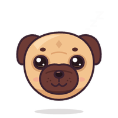
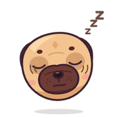
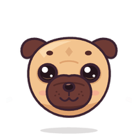
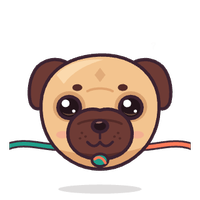
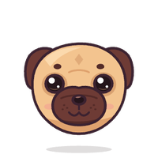
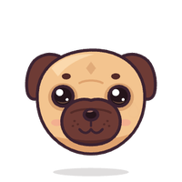

<p align="center">
  
</p>

<h1 align="center">PushPal</h1>

<p align="center">
  <b>Know the moment a teammate pushes. Pull their code in with one click. Never lose your work.</b>
</p>

<p align="center">
  <a href="https://github.com/Pug-03/PushPug/actions/workflows/ci.yml"></a>
  
  
  
</p>

<p align="center">
  <picture>
    <source media="(prefers-color-scheme: dark)" srcset="docs/demo-dark.gif">
    
  </picture>
</p>

<p align="center">
  <a href="#what-it-does">What it does</a> ·
  <a href="#getting-started">Getting started</a> ·
  <a href="#everyday-use">Everyday use</a> ·
  <a href="#settings">Settings</a> ·
  <a href="#privacy">Privacy</a> ·
  <a href="#troubleshooting">Troubleshooting</a>
</p>

---

## What it does

You're building something with friends on GitHub. Someone pushes, you don't notice, you keep working on old
code — and when you finally push, everything conflicts.

**PushPal watches the remote for you.** The moment a teammate pushes, it tells you who pushed what, warns you
if they touched a file you're editing, and pulls their code in with one click — your uncommitted work is set
aside and put back afterwards. When something does go wrong, it explains it in plain words and shows you how
to fix it. It's made for people who are new to Git, and for everyone who'd rather not think about it.

<table>
<tr>
<td width="50%" valign="top">

**🔔 Know the moment they push**<br>
One alert per push: who, how many commits, the latest message — in VS Code or as a desktop notification,
even when VS Code is closed.

**⬇️ Pull in one click, lose nothing**<br>
Your uncommitted work is parked and restored. Changed your mind? **Undo** the merge for 10 minutes.

**🧭 Conflicts and errors, explained**<br>
The conflicted files open in the Merge Editor with a guide. Git errors become a sentence and the fix.

</td>
<td width="50%" valign="top">

**✅ GitHub checks for every commit**<br>
After every push — yours or a teammate's — you're told whether the tests passed, and what broke when they
didn't.

**🛡️ Push without surprises**<br>
PushPal checks the remote before pushing and offers **Merge, then push for me** instead of a rejected push.

**🔋 Fast or frugal**<br>
From ⚡ every 10 s to 🔋 battery saver, plus checking hours, do-not-disturb and **Mute 1 hour**.

</td>
</tr>
</table>

<p align="center">
  <picture>
    <source media="(prefers-color-scheme: dark)" srcset="docs/screenshots/en/team-behind-dark.png">
    
  </picture>
  <picture>
    <source media="(prefers-color-scheme: dark)" srcset="docs/screenshots/en/team-checks-dark.png">
    
  </picture>
  <picture>
    <source media="(prefers-color-scheme: dark)" srcset="docs/screenshots/en/team-conflictMerge-dark.png">
    
  </picture>
</p>

### Meet Pal

Pal is the pug who lives in the **My Team** view. Its face tells you what's going on — and it wiggles when
you poke it.

<table align="center">
<tr>
<td align="center"><br><sub>Up to date</sub></td>
<td align="center"><br><sub>Teammate pushed</sub></td>
<td align="center"><br><sub>Pulling</sub></td>
<td align="center"><br><sub>Conflict</sub></td>
<td align="center"><br><sub>Checks passed</sub></td>
<td align="center"><br><sub>Checks failed</sub></td>
</tr>
</table>

---

## Getting started

### Step 1 — Install PushPal

**From the Marketplace** *(recommended — updates install automatically)*

1. Open VS Code → **Extensions** (`⇧⌘X` on macOS, `Ctrl+Shift+X` on Windows / Linux).
2. Search for **PushPal** → **Install**.

*Cursor, VSCodium or Windsurf?* PushPal is on **Open VSX** too — search the same way in their Extensions view.

**From a `.vsix` file**

1. Download `pushpal-x.y.z.vsix` from [Releases](https://github.com/Pug-03/PushPug/releases).
2. Command Palette (`⇧⌘P` / `Ctrl+Shift+P`) → **Extensions: Install from VSIX…** → pick the file.

A `.vsix` install doesn't update itself — install the newer file over it when a new version comes out.

### Step 2 — Set up your computer

<details>
<summary><b>🍎 macOS</b></summary>
<br>

1. **Notifications with buttons** (recommended): install [alerter](https://github.com/vjeantet/alerter) so
   alerts get a **Pull in changes** button and stay on screen until you click.
   ```bash
   brew install vjeantet/tap/alerter
   ```
   You can also do this from the setup wizard's *Test* step.
2. Open **System Settings → Notifications → alerter** (or **Visual Studio Code**) → set the alert style to
   **Persistent**.
3. *(Optional)* **GitHub checks while VS Code is closed** — install the GitHub CLI and sign in once:
   ```bash
   brew install gh && gh auth login
   ```

If you turn on **alerts while VS Code is closed**, macOS shows a one-time *“Background item added”* notice —
that's PushPal's small LaunchAgent. Turning the option off removes it.

</details>

<details>
<summary><b>🪟 Windows</b></summary>
<br>

1. **Notifications** work out of the box (Windows toasts with **Pull in changes** / **Later** buttons).
2. If you don't see them: **Settings → System → Notifications** → turn notifications on for
   **Visual Studio Code** (or **Windows PowerShell**), and turn off **Do not disturb / Focus**.
3. *(Optional)* **GitHub checks while VS Code is closed** — install the GitHub CLI and sign in once:
   ```powershell
   winget install --id GitHub.cli
   gh auth login
   ```

**Alerts while VS Code is closed** use a hidden Task Scheduler task (*PushPal Watcher*). No console window ever
pops up, and turning the option off deletes the task.

</details>

<details>
<summary><b>🐧 Linux</b></summary>
<br>

Desktop notifications use `notify-send` (package `libnotify-bin` or `libnotify`). Alerts while VS Code is
closed aren't available on Linux; everything else works.

</details>

### Step 3 — Run the setup wizard

The wizard opens by itself after installing (run it again any time with **PushPal: Run Setup Again**).
Eight short steps, all skippable:

| | |
|---|---|
| **Language & theme** | Thai or English; light, dark or match VS Code |
| **Notifications** | in VS Code, on your desktop, even when VS Code is closed; do-not-disturb hours |
| **How often to check** | ⚡ Fastest · ⚖️ Balanced · 🔋 Battery saver · 🛠 Custom |
| **GitHub** | sign in with VS Code's GitHub account to get test results |
| **Test** | send a test notification to see that it works |

<p align="center">
  <picture>
    <source media="(prefers-color-scheme: dark)" srcset="docs/screenshots/en/wizard-1-welcome-dark.png">
    
  </picture>
  <picture>
    <source media="(prefers-color-scheme: dark)" srcset="docs/screenshots/en/wizard-6-github-dark.png">
    
  </picture>
</p>

### Step 4 — Open your project

Open a folder that's a git repository (cloned from GitHub or any remote). Look at the **status bar**, bottom
left: **✓ Up to date**, or **⬇ 3 new from your team** in yellow. Click Pal in the **Activity Bar** for
**My Team**: the timeline, conflicts and checks. That's all — PushPal takes it from here.

---

## Everyday use

### Pull in your teammates' code

Press **Pull in changes** in the alert, the yellow status bar item, or **My Team**. PushPal merges their
commits while your uncommitted work is set aside and put back: *“Merged! Got 3 commits — your own work is all
still here.”*

### Undo a merge you didn't want

Press **Undo this merge** (in the message or the card in **My Team**), or run **PushPal: Undo Last Merge**.
For 10 minutes it restores everything exactly as before — commits, staged and unstaged changes, new files.
If you've committed or edited since, PushPal doesn't undo and tells you why, so nothing of yours is lost.

### Fix a conflict

PushPal opens the conflicted files and the Merge Editor, and **My Team** explains what *Accept Current /
Incoming / Both* mean for your situation. Fix each file and save, then:

- conflict with your **commits** → press **Finish merge**;
- conflict with your **uncommitted work** → stage the files (＋ in Source Control).

### Push without getting rejected

Run **PushPal: Push (Check First)** — also in the Source Control title bar and in **My Team**. If a teammate
pushed in the meantime you get **Merge, then push for me**. VS Code's own **Push** / **Sync** get the same
explanation and fix when they're rejected.

### See whether the tests passed

Sign in to GitHub once (wizard, **PushPal Settings → GitHub**, or when PushPal asks). Then:

- after **your** push: *✅ All checks passed (4/4)* or *❌ Checks failed: 1 of 4 — Test (ubuntu-latest)*;
- a **teammate's** failing push: *“maybe don't pull it yet”* with **See what broke · Pull anyway · Later** —
  and a heads-up when it's fixed;
- the status bar shows ✓ / ✗ / ⏳ for the latest commit;
- in **My Team**, click a commit's badge for every check; **Why did it fail?** shows the failing step, the last
  30 lines of its log and a plain-language hint.

Skipped, neutral and cancelled checks don't count as failures.

### Choose how often PushPal checks

**PushPal Settings → Frequency & battery**, or **PushPal: Switch Check Mode**:

| Mode | Checks | Good for |
|---|---|---|
| ⚡ Fastest | every 10 s | teams pushing all day |
| ⚖️ Balanced *(default)* | every 30 s | most people |
| 🔋 Battery saver | every 60 s, slower when idle or on battery | laptops on the go |
| 🛠 Custom | your values | full control |

Each mode shows what it costs, e.g. *120 checks/hour · ≈ 655 KB/hour*, based on measured `git fetch` sizes.

### Don't be disturbed

Set **do-not-disturb hours** (e.g. 22:00–08:00) or press **Mute 1 hour** on any alert. No pop-ups or desktop
notifications meanwhile; the status bar keeps updating and anything you missed is announced afterwards.

<p align="center">
  <picture>
    <source media="(prefers-color-scheme: dark)" srcset="docs/screenshots/en/settings-frequency-dark.png">
    
  </picture>
  <picture>
    <source media="(prefers-color-scheme: dark)" srcset="docs/screenshots/en/team-undo-dark.png">
    
  </picture>
</p>

---

## Settings

Everything is in **PushPal Settings** (gear icon in **My Team**, or **PushPal: Open Settings**) and mirrored in
VS Code's Settings — change either, the other follows instantly.

| Setting | Default | |
|---|---|---|
| `pushpal.mode` | `balanced` | `fast`, `balanced`, `batterySaver`, `custom` |
| `pushpal.checkIntervalSeconds` | `30` | while VS Code is open (10–300) |
| `pushpal.background.intervalSeconds` | `120` | while VS Code is closed (60–3600) |
| `pushpal.battery.*` | on | idle / low battery / Low Power Mode slow-downs; plugged in = normal |
| `pushpal.activeHours.*` | off | only check between two times |
| `pushpal.notify.inVSCode` / `.desktop` | on | where alerts appear |
| `pushpal.notify.background` | off | alerts while VS Code is closed (macOS, Windows) |
| `pushpal.notify.sameFileWarning` | on | extra warning for files you're also editing |
| `pushpal.quiet.enabled` / `.start` / `.end` | off · 22:00–08:00 | do-not-disturb hours |
| `pushpal.actions.enabled` | on | GitHub checks |
| `pushpal.actions.notifyOnPass` | on | also tell me when checks pass |
| `pushpal.actions.notifyFor` | `all` | `all`, `mine`, `team` |
| `pushpal.avatars` | on | commit authors' GitHub profile pictures |
| `pushpal.language` / `pushpal.theme` | auto · system | Thai or English; light, dark or match VS Code |

## Privacy

- **No telemetry.** Nothing about you or your code is collected.
- Your normal `git fetch` / `pull` / `push` go to your own remote.
- For **github.com** projects only, and only if enabled: test results and profile pictures are read from
  GitHub's API with **VS Code's built-in GitHub sign-in**. PushPal never asks you to paste a token and never
  saves one. While tests are running it asks every 20–30 s, stops when they're done, and slows down by itself
  near GitHub's rate limit.
- The optional background task only runs `git fetch` (and `gh api` for test results if you use the GitHub
  CLI). It never pulls or changes your files.

## Troubleshooting

<details>
<summary><b>I don't get desktop notifications</b></summary>
<br>

Send a test from the wizard (**PushPal: Run Setup Again** → *Test*). Then check your system's notification
settings (Step 2 above), and PushPal's own **do-not-disturb hours** and **Mute 1 hour**.

</details>

<details>
<summary><b>“Couldn't sign in to the remote”</b></summary>
<br>

PushPal uses the same git as your terminal. Press **Sync** once in Source Control to sign in, then PushPal can
check again. It never asks for passwords itself.

</details>

<details>
<summary><b>No test results show up</b></summary>
<br>

They appear for github.com projects that have checks (e.g. GitHub Actions), after you've signed in under
**PushPal Settings → GitHub**. If you chose *No thanks* earlier, turn **GitHub checks** back on there.

</details>

<details>
<summary><b>Pal doesn't move after an update</b></summary>
<br>

Run **Developer: Reload Window** once — open panels keep the old version until they're reloaded.

</details>

<details>
<summary><b>Removing PushPal</b></summary>
<br>

Uninstall it from the Extensions view. The background task (if you turned it on) is removed with it.

</details>

---

## Development

```bash
npm install
npm test            # real git repos (bare remote + two clones) and a mocked GitHub API
npm run build
npm run smoke       # runs the extension in your local VS Code with an isolated profile (macOS)
npm run screenshots # renders every screen into docs/screenshots/ (English copies in docs/screenshots/en/)
npm run package     # builds pushpal-<version>.vsix
node scripts/mascot-render.mjs gifs   # re-records Pal's animations into docs/mascot/
```

Design decisions: [DECISIONS.md](DECISIONS.md) · Publishing: [PUBLISHING.md](PUBLISHING.md) ·
Releasing: `npm run release` (bumps the version and pushes a tag; CI tests, packages and publishes).

## License

[MIT](LICENSE) · Pal the pug is an original drawing made for PushPal.
