<p align="center">
  
</p>

<h1 align="center">PushPug</h1>

<p align="center">
  <b>Know the moment a teammate pushes. Pull their code in with one click. Never lose your work.</b>
</p>

<p align="center">
  <a href="https://github.com/Pug-03/PushPug/actions/workflows/ci.yml"></a>
  
  
  
</p>

<p align="center">
  <a href="#what-it-does">What it does</a> ·
  <a href="#installation-guide">Installation guide</a> ·
  <a href="#what-youll-see-and-what-to-do">What you'll see</a> ·
  <a href="#settings">Settings</a> ·
  <a href="#privacy">Privacy</a> ·
  <a href="#troubleshooting">Troubleshooting</a>
</p>

---

## What it does

You're building something with friends on GitHub. Someone pushes, you don't notice, you keep working on old
code — and when you finally push, everything conflicts.

**PushPug watches the remote for you.** The moment a teammate pushes, it tells you who pushed what, warns you
if they touched a file you're editing, and pulls their code in with one click — your uncommitted work is set
aside and put back afterwards. When something does go wrong, it explains it in plain words and shows you how
to fix it. It's made for people who are new to Git, and for everyone who'd rather not think about it.

- **Know the moment they push** — in VS Code or as a desktop notification, even when VS Code is closed
- **Pull in one click, lose nothing** — and **undo** the merge for 10 minutes if you change your mind
- **Conflicts and Git errors explained** — in plain words, with the fix
- **GitHub test results for every commit** — yours and your teammates'
- **Push without surprises** — PushPug checks the remote first
- **Pull requests made easy** — start a task on its own branch, send it for review in one click, and hear when
  it's merged or conflicts with main
- **Fast or frugal** — from every 10 s to battery saver, plus do-not-disturb hours

---

## Installation guide

This guide goes one click at a time. The pictures are drawings of the screens you'll see; the red numbers in each
picture match the numbered steps under it. Pick **one** way to install (Part A, B or C), then do the part for your
computer (D, E or F), then the setup wizard (G).

| Part | What it covers | Who needs it |
|---|---|---|
| [Before you start](#before-you-start) | VS Code and Git | everyone |
| [A. Install from GitHub](#a-install-from-github-the-vsix-file) | download the `.vsix` file and install it | everyone, until PushPug is on the Marketplace |
| [B. Install from the Marketplace](#b-install-from-the-marketplace-or-open-vsx) | search and press Install | once it's published |
| [C. Build it yourself](#c-build-it-yourself-from-the-source-code) | from the source code | developers |
| [D. macOS setup](#d-macos-setup) | notifications with buttons | Mac users |
| [E. Windows setup](#e-windows-setup) | turn on notifications | Windows users |
| [F. Linux setup](#f-linux-setup) | `notify-send` | Linux users |
| [G. The setup wizard](#g-the-setup-wizard) | language, alerts, how often to check, GitHub | everyone |
| [H. Open your project](#h-open-your-project) | where to find PushPug | everyone |
| [Update or uninstall](#update-or-uninstall) | newer versions, removing it | later |

### Before you start

You need two programs. Check them first:

1. **Visual Studio Code, version 1.90 or newer.**
   - Don't have it? Download it from [code.visualstudio.com](https://code.visualstudio.com) and install it.
   - Check the version: on macOS open the menu **Code → About Visual Studio Code**; on Windows and Linux open
     **Help → About**. The first line says the version, e.g. `Version: 1.95.3`.
   - Too old? Open **Code → Check for Updates…** (macOS) or **Help → Check for Updates…** (Windows / Linux).
2. **Git.**
   - Check it: open a terminal (in VS Code: **Terminal → New Terminal**) and type `git --version`, then press
     Enter. If you see something like `git version 2.44.0`, you're done.
   - If you see *command not found*: on macOS run `xcode-select --install` and press **Install** in the window
     that opens; on Windows download it from [git-scm.com](https://git-scm.com/download/win) and keep every
     default in the installer; on Linux use your package manager (e.g. `sudo apt install git`).
   - Restart VS Code after installing Git.

### A. Install from GitHub (the `.vsix` file)

A `.vsix` file is a VS Code extension packed into one file. You download it once and give it to VS Code.

**A1. Open the releases.** Go to [github.com/Pug-03/PushPug](https://github.com/Pug-03/PushPug). On the right side
of the page, under **About**, click **Releases** **(1)**. Or go straight to the
[latest release](https://github.com/Pug-03/PushPug/releases/latest).

<p align="center">
  <picture>
    <source media="(prefers-color-scheme: dark)" srcset="docs/guide/gh-releases-link-dark.png">
    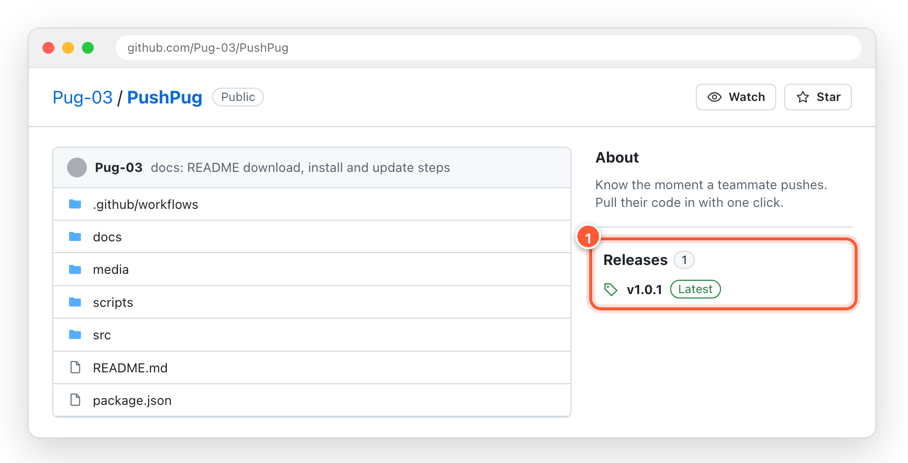
  </picture>
</p>

**A2. Download the file.** Scroll down to **Assets** and click **`pushpug-x.y.z.vsix`** **(2)** (`x.y.z` is the
version, e.g. `pushpug-1.0.0.vsix`). Don't take *Source code (zip)* — that's the source, not the extension.

The file lands in your **Downloads** folder. If your browser says *"This type of file isn't commonly
downloaded"*, choose **Keep**.

<p align="center">
  <picture>
    <source media="(prefers-color-scheme: dark)" srcset="docs/guide/gh-assets-dark.png">
    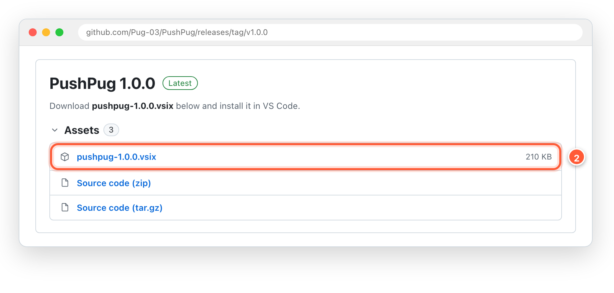
  </picture>
</p>

**A3. Open the Extensions view.** In VS Code, click the **Extensions** icon (four squares) in the bar on the far
left **(3)**. Shortcut: `⇧⌘X` on macOS, `Ctrl+Shift+X` on Windows / Linux.

**A4. Open the menu.** At the top of the Extensions panel, click **`…`** (*Views and More Actions*) **(4)**.

**A5. Choose Install from VSIX.** In the menu, click **Install from VSIX…** **(5)**.

<p align="center">
  <picture>
    <source media="(prefers-color-scheme: dark)" srcset="docs/guide/vsc-install-vsix-dark.png">
    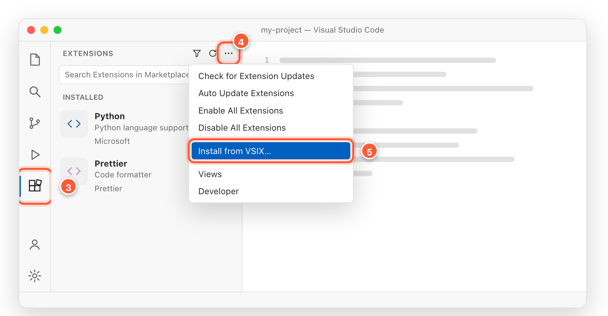
  </picture>
</p>

<details>
<summary><b>Can't find the <code>…</code> menu? Use the Command Palette instead</b></summary>
<br>

Press `⇧⌘P` (macOS) or `Ctrl+Shift+P` (Windows / Linux), type `Install from VSIX` **(1)** and press Enter on
**Extensions: Install from VSIX…** **(2)**. Then carry on with A6.

<p align="center">
  <picture>
    <source media="(prefers-color-scheme: dark)" srcset="docs/guide/vsc-palette-vsix-dark.png">
    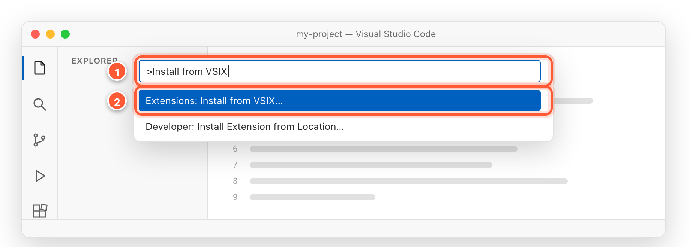
  </picture>
</p>

</details>

**A6. Pick the file.** A file window opens. Go to **Downloads** and click **`pushpug-x.y.z.vsix`** **(6)**.

**A7. Install.** Click **Install** **(7)**. (On Windows the window looks different, but the button is also
called **Install**.)

<p align="center">
  <picture>
    <source media="(prefers-color-scheme: dark)" srcset="docs/guide/pick-vsix-dark.png">
    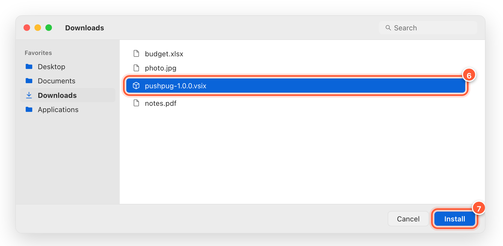
  </picture>
</p>

**A8. Check it worked.** After a few seconds:

- the pug icon appears in the bar on the left **(8)** — that's PushPug;
- the message *"Completed installing extension PushPug from VSIX."* shows at the bottom right **(9)**;
- the setup wizard opens by itself. Go to [G. The setup wizard](#g-the-setup-wizard) — but first do D, E or F for
  your computer if you want desktop notifications.

<p align="center">
  <picture>
    <source media="(prefers-color-scheme: dark)" srcset="docs/guide/vsc-installed-dark.png">
    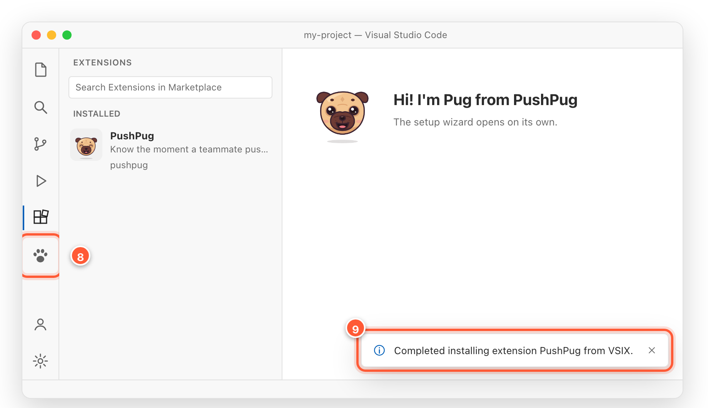
  </picture>
</p>

You can delete the `.vsix` file from Downloads now; VS Code keeps its own copy.

### B. Install from the Marketplace or Open VSX

*Available once PushPug is published. Until then, use A.*

1. Click the **Extensions** icon on the left **(1)**.
2. Type **PushPug** in the search box at the top **(2)**.
3. Click **Install** next to PushPug **(3)**. Updates then install by themselves.

<p align="center">
  <picture>
    <source media="(prefers-color-scheme: dark)" srcset="docs/guide/vsc-marketplace-dark.png">
    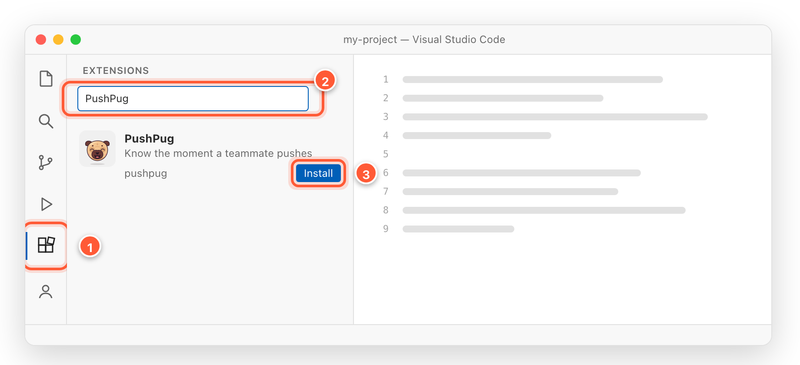
  </picture>
</p>

Cursor, VSCodium and Windsurf use **Open VSX** — search the same way in their Extensions view.

### C. Build it yourself from the source code

Needs [Node.js](https://nodejs.org) 20 or newer (check with `node --version`).

```bash
git clone https://github.com/Pug-03/PushPug.git
cd PushPug
npm install
npm run package          # creates pushpug-x.y.z.vsix in this folder
```

Then install that `.vsix` file as in **A3–A8**; in A6 pick it from the `PushPug` folder instead of Downloads.

### D. macOS setup

PushPug works without this part, but alerts then have no buttons and disappear after a few seconds.

**D1. Install alerter** — a small free helper that gives alerts a **Pull in changes** button and keeps them on
screen until you click. The easiest way: in the setup wizard's **Test** step, press **Install alerter**. Or open
**Terminal** and run:

```bash
brew install vjeantet/tap/alerter
```

If it says `brew: command not found`, install Homebrew first from [brew.sh](https://brew.sh) (copy the one line
on that page into Terminal), then run the command above again.

**D2. Let it show alerts and keep them on screen.** Send one test notification first (wizard **Test** step →
**Send test notification**), so alerter appears in the list. Then:

1. Open **System Settings** (Apple menu ) and click **Notifications** in the sidebar **(1)**.
2. Find **alerter** in the app list and click it (use **Visual Studio Code** if you skipped D1). Turn on
   **Allow notifications** **(2)**.
3. Under the alert style, choose **Persistent** **(3)** so alerts stay until you click them.

<p align="center">
  <picture>
    <source media="(prefers-color-scheme: dark)" srcset="docs/guide/mac-notifications-dark.png">
    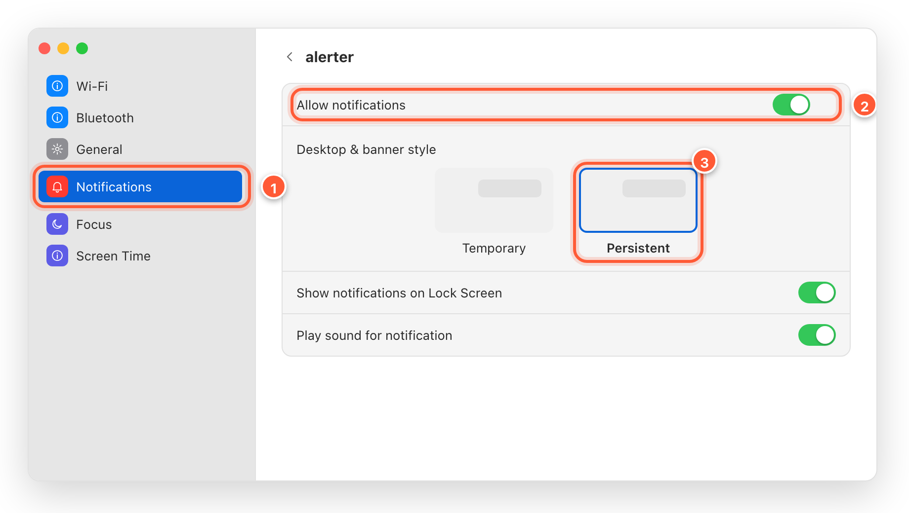
  </picture>
</p>

**D3. (Optional) GitHub test results while VS Code is closed** — install the GitHub CLI and sign in once:

```bash
brew install gh && gh auth login
```

Answer the questions with the arrow keys and Enter: **GitHub.com → HTTPS → Login with a web browser**, then paste
the code shown into the page that opens.

If you turn on **alerts while VS Code is closed**, macOS shows a one-time *"Background item added"* notice —
that's PushPug's small LaunchAgent. Turning the option off removes it.

### E. Windows setup

Notifications with **Pull in changes** / **Later** buttons work out of the box. If you don't see them:

1. Open **Start → Settings → System → Notifications** and turn **Notifications** **On** **(1)**.
2. Turn **Do not disturb** **Off** **(2)** (on some versions it's under **Focus**).
3. Scroll to *Notifications from apps and other senders* and turn **Visual Studio Code** **On** **(3)**. Turn on
   **Windows PowerShell** too — alerts sent while VS Code is closed come from it.

<p align="center">
  <picture>
    <source media="(prefers-color-scheme: dark)" srcset="docs/guide/win-notifications-dark.png">
    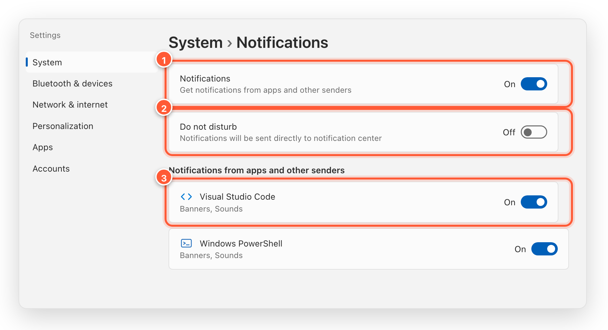
  </picture>
</p>

**(Optional) GitHub test results while VS Code is closed** — open **PowerShell** and run:

```powershell
winget install --id GitHub.cli
gh auth login
```

Close and reopen PowerShell between the two lines if `gh` isn't found.

**Alerts while VS Code is closed** use a hidden Task Scheduler task (*PushPug Watcher*). No console window ever
pops up, and turning the option off deletes the task.

### F. Linux setup

Desktop notifications use `notify-send`. Install it if it's missing:

```bash
sudo apt install libnotify-bin      # Debian, Ubuntu, Mint
sudo dnf install libnotify          # Fedora
sudo pacman -S libnotify            # Arch
```

Check it with `notify-send "Hello"` — a notification should pop up. Alerts while VS Code is closed aren't
available on Linux; everything else works.

### G. The setup wizard

The wizard opens by itself right after installing. To open it again later: press `⇧⌘P` / `Ctrl+Shift+P` and run
**PushPug: Run Setup Again**. Every step can be skipped and changed later in **PushPug Settings**.

| Step | What to do |
|---|---|
| **1. Welcome** | press **Let's go** (or **Skip setup** to keep the defaults) |
| **2. Language** | Thai or English |
| **3. Theme** | light, dark, or match VS Code |
| **4. Notifications** | where alerts appear: in VS Code, on your desktop, even when VS Code is closed; do-not-disturb hours |
| **5. How often to check** | Fastest, Balanced (good for most people), Battery saver or Custom |
| **6. GitHub** | press **Sign in with GitHub** to see test results; VS Code asks to allow it — press **Allow** |
| **7. Test** | press **Send test notification**; one should pop up. On a Mac, install alerter here (D1) |
| **8. Done** | press **Start using PushPug** |

<p align="center">
  <picture>
    <source media="(prefers-color-scheme: dark)" srcset="docs/screenshots/en/wizard-1-welcome-dark.png">
    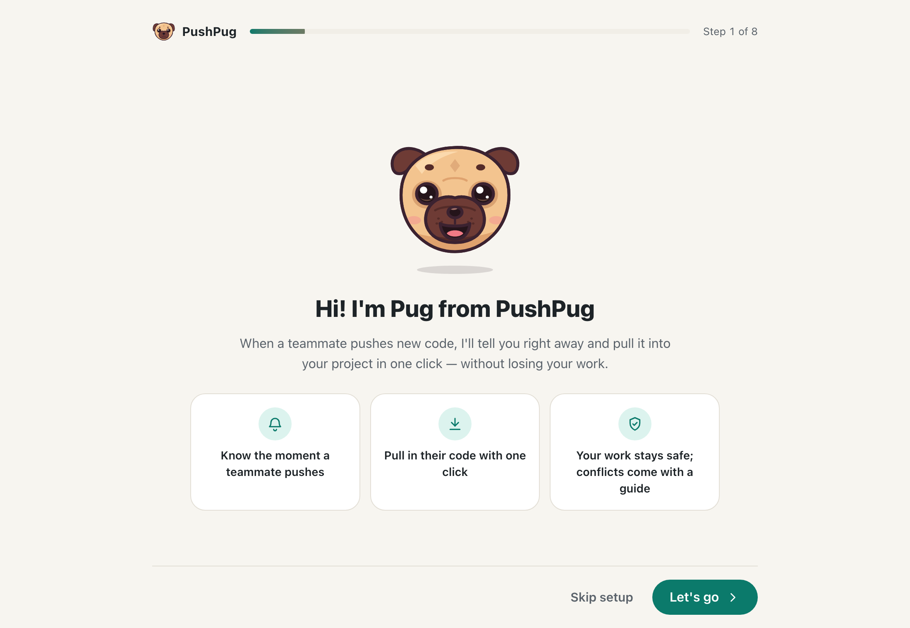
  </picture>
  <picture>
    <source media="(prefers-color-scheme: dark)" srcset="docs/screenshots/en/wizard-5-frequency-dark.png">
    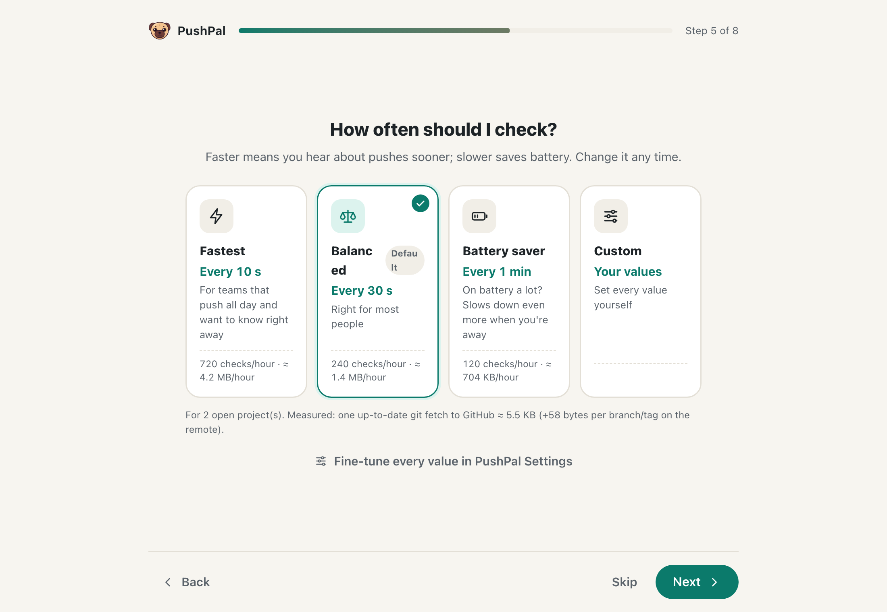
  </picture>
</p>
<p align="center">
  <picture>
    <source media="(prefers-color-scheme: dark)" srcset="docs/screenshots/en/wizard-6-github-dark.png">
    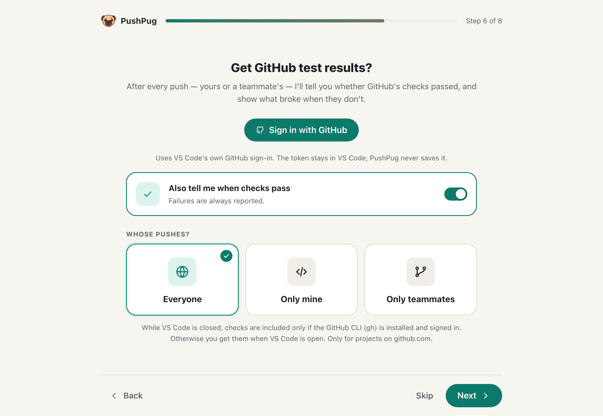
  </picture>
</p>

### H. Open your project

1. Open a folder that's a git repository: **File → Open Folder…**, or clone one with **Source Control → Clone
   Repository**.
2. Click the **pug icon** in the bar on the left **(1)** to open **My Team**.
3. Look at the **status bar** at the bottom left **(2)**. **Up to date** means PushPug is watching and you have
   everything. That's all — the next section shows every screen you'll meet and what to do.

<p align="center">
  <picture>
    <source media="(prefers-color-scheme: dark)" srcset="docs/guide/vsc-first-run-dark.png">
    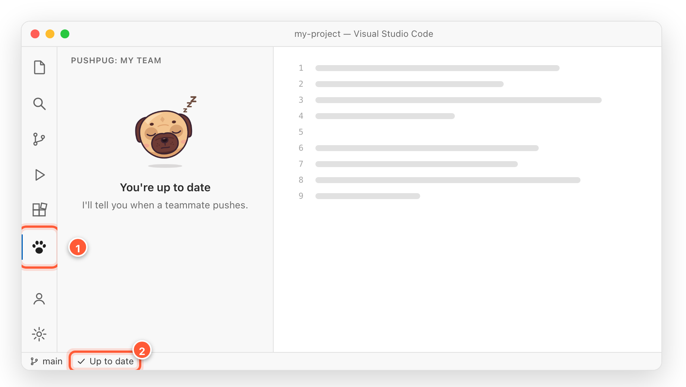
  </picture>
</p>

### Update or uninstall

**Which version do I have?** Open the Extensions view and click **PushPug**. The version is next to the name
**(1)**.

<p align="center">
  <picture>
    <source media="(prefers-color-scheme: dark)" srcset="docs/guide/vsc-version-dark.png">
    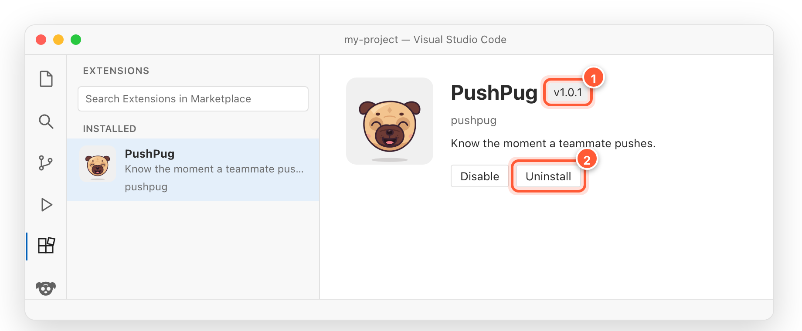
  </picture>
</p>

**Update:**

| You installed it… | To update |
|---|---|
| **from the Marketplace / Open VSX** (B) | Nothing to do — VS Code updates it by itself. |
| **from a `.vsix` file** (A) | Download the newer `.vsix` from [Releases](https://github.com/Pug-03/PushPug/releases/latest) (A1–A2) and install it the same way (A3–A7). VS Code replaces the old version; your settings stay. Then press `⇧⌘P` / `Ctrl+Shift+P` and run **Developer: Reload Window**. |
| **by building it** (C) | In the `PushPug` folder: `git pull`, `npm install`, `npm run package`, then install the new `.vsix`. |

**Get an e-mail when there's a new version:** on the [GitHub page](https://github.com/Pug-03/PushPug) click
**Watch** **(1)** → **Custom** **(2)** → tick **Releases** **(3)** → **Apply** **(4)**. You need to be signed in
to GitHub.

<p align="center">
  <picture>
    <source media="(prefers-color-scheme: dark)" srcset="docs/guide/gh-watch-releases-dark.png">
    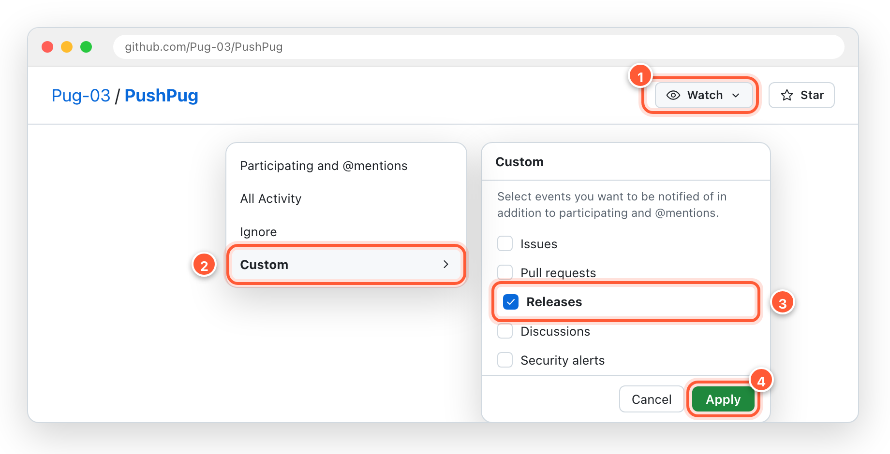
  </picture>
</p>

**Uninstall:** on the PushPug extension page click **Uninstall** **(2)** in the picture above, then **Developer:
Reload Window**. The background task (if you turned it on) is removed with it.


---

## What you'll see, and what to do

Every situation has its own screen in **My Team**, and Pug's face matches it.

<table>
<tr><td colspan="2"><h3>You're up to date</h3></td></tr>
<tr>
<td width="240" valign="top">
<picture>
  <source media="(prefers-color-scheme: dark)" srcset="docs/screenshots/en/team-upToDate-dark.png">
  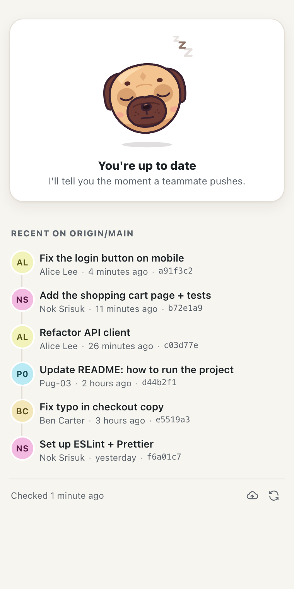
</picture>
</td>
<td valign="top">

**What it means:** you have everything your teammates pushed. The status bar shows **Up to date**.

**What to do:** nothing — keep coding. PushPug keeps checking in the background.

</td>
</tr>

<tr><td colspan="2"><h3>A teammate pushed</h3></td></tr>
<tr>
<td valign="top">
<picture>
  <source media="(prefers-color-scheme: dark)" srcset="docs/screenshots/en/team-behind-dark.png">
  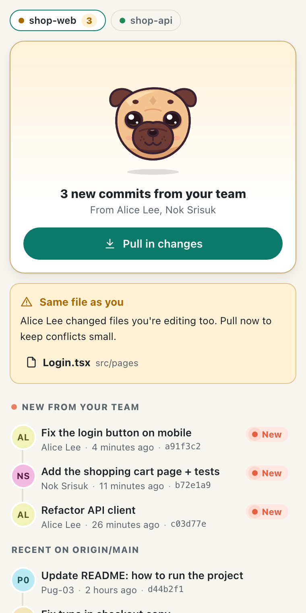
</picture>
</td>
<td valign="top">

**What it means:** there are new commits on the remote. You get an alert, the status bar turns yellow
(**3 new from your team**), and new commits are marked **New** in the timeline. **Same file as you** means
they changed a file you're editing too.

**What to do:** press **Pull in changes** (in the alert, the status bar or here). The sooner you pull, the
smaller any conflict will be.

</td>
</tr>

<tr><td colspan="2"><h3>Pulling in their code</h3></td></tr>
<tr>
<td valign="top">
<picture>
  <source media="(prefers-color-scheme: dark)" srcset="docs/screenshots/en/team-pulling-dark.png">
  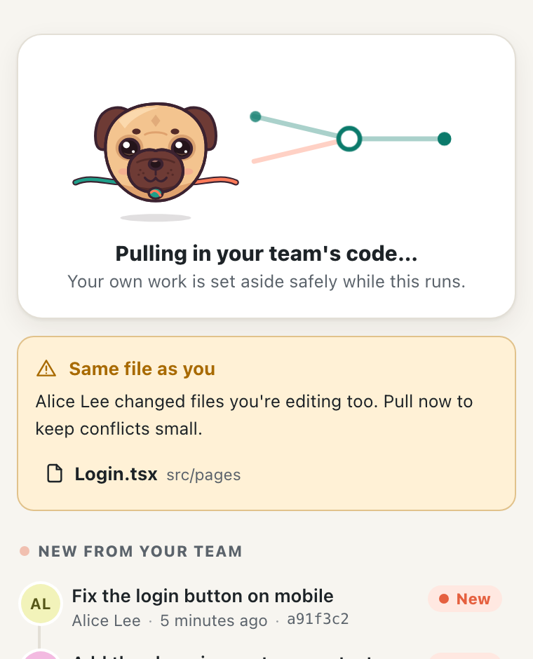
</picture>
</td>
<td valign="top">

**What it means:** PushPug is merging their commits. Your uncommitted work is set aside safely while it runs.

**What to do:** wait a second.

</td>
</tr>

<tr><td colspan="2"><h3>Merged</h3></td></tr>
<tr>
<td valign="top">
<picture>
  <source media="(prefers-color-scheme: dark)" srcset="docs/screenshots/en/team-success-dark.png">
  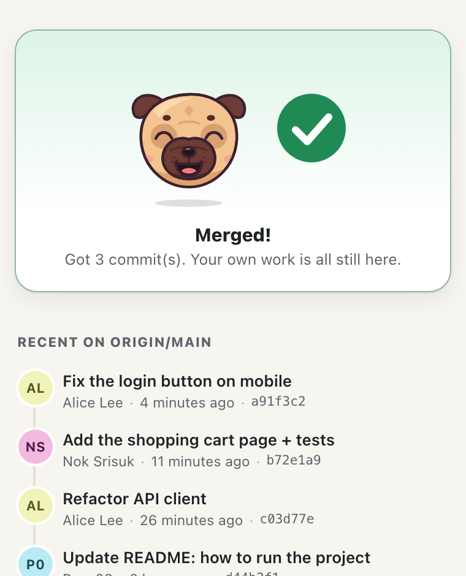
</picture>
<br>
<picture>
  <source media="(prefers-color-scheme: dark)" srcset="docs/screenshots/en/team-undo-dark.png">
  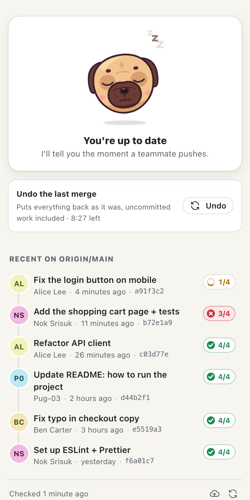
</picture>
</td>
<td valign="top">

**What it means:** their commits are in, and your own work is all still there.

**What to do:** carry on. Changed your mind? Press **Undo** on the card (or run **PushPug: Undo Last Merge**)
within 10 minutes: everything goes back exactly as it was — commits, staged and unstaged changes, new files.
If you've committed or edited since, PushPug won't undo and tells you why, so nothing of yours is lost.

</td>
</tr>

<tr><td colspan="2"><h3>Conflict: your commits and theirs changed the same lines</h3></td></tr>
<tr>
<td valign="top">
<picture>
  <source media="(prefers-color-scheme: dark)" srcset="docs/screenshots/en/team-conflictMerge-dark.png">
  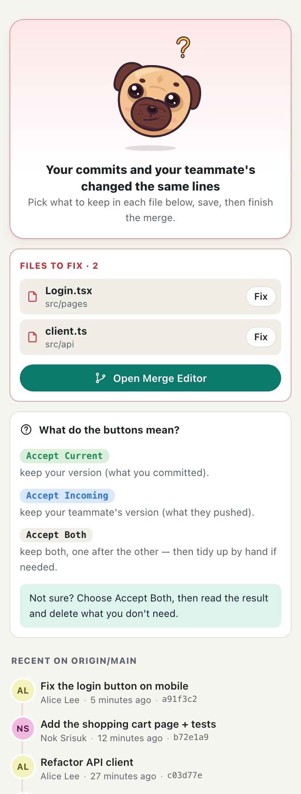
</picture>
</td>
<td valign="top">

**What it means:** Git can't decide which version to keep. The status bar turns red (**Conflicts to fix**).

**What to do:**
1. Press **Fix** next to a file (or **Open Merge Editor**).
2. In each conflict choose **Accept Current** (*your* version), **Accept Incoming** (*your teammate's*) or
   **Accept Both** — the card under the files explains them.
3. Save every file, then press **Finish merge**.

</td>
</tr>

<tr><td colspan="2"><h3>Conflict: their code overlaps work you haven't committed</h3></td></tr>
<tr>
<td valign="top">
<picture>
  <source media="(prefers-color-scheme: dark)" srcset="docs/screenshots/en/team-conflictAutostash-dark.png">
  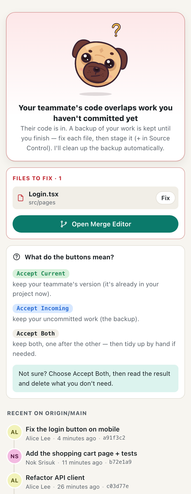
</picture>
</td>
<td valign="top">

**What it means:** their code is already in; putting your uncommitted work back on top of it clashed. A backup
of your work is kept until you're done.

**What to do:** fix each file the same way — but here **Current** is your teammate's code and **Incoming** is
*your* uncommitted work (PushPug's help card says so). Then **stage** the files (＋ in Source Control).
PushPug removes the backup by itself.

</td>
</tr>

<tr><td colspan="2"><h3>Every conflict fixed</h3></td></tr>
<tr>
<td valign="top">
<picture>
  <source media="(prefers-color-scheme: dark)" srcset="docs/screenshots/en/team-mergeReady-dark.png">
  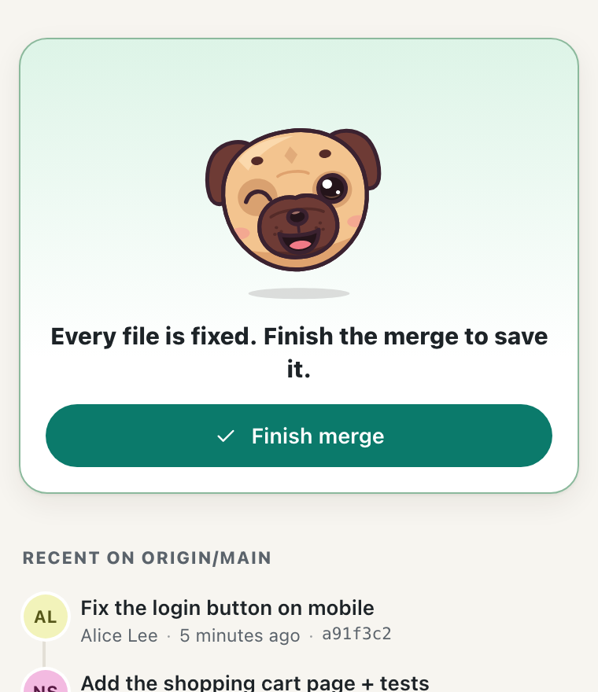
</picture>
</td>
<td valign="top">

**What it means:** all files are resolved, but the merge isn't saved yet.

**What to do:** press **Finish merge**.

</td>
</tr>

<tr><td colspan="2"><h3>Test results on GitHub</h3></td></tr>
<tr>
<td valign="top">
<picture>
  <source media="(prefers-color-scheme: dark)" srcset="docs/screenshots/en/team-checks-dark.png">
  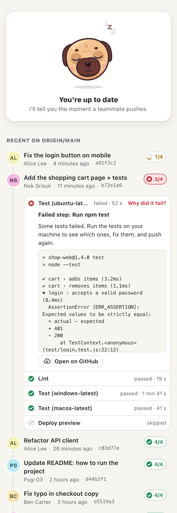
</picture>
</td>
<td valign="top">

**What it means:** each commit has a badge — a spinning circle while tests run, a tick and **4/4** when all passed, a cross and **3/4** when something
failed. The status bar shows the same for the latest commit. You're told when your push passes or fails, and
when a teammate's push fails you get *“maybe don't pull it yet”* with **See what broke · Pull anyway · Later**
(and a heads-up once it's fixed). Skipped, neutral and cancelled checks don't count as failures.

**What to do:** click a badge to see every check. On a failed one press **Why did it fail?** for the failing
step, the last 30 lines of its log, a hint in plain words (failing tests, install, lint, timeout, build) and
**Open on GitHub**.

*Needs a one-time sign-in to GitHub (wizard or **PushPug Settings → GitHub**). Only for github.com projects.*

</td>
</tr>

<tr><td colspan="2"><h3>I couldn't check</h3></td></tr>
<tr>
<td valign="top">
<picture>
  <source media="(prefers-color-scheme: dark)" srcset="docs/screenshots/en/team-error-dark.png">
  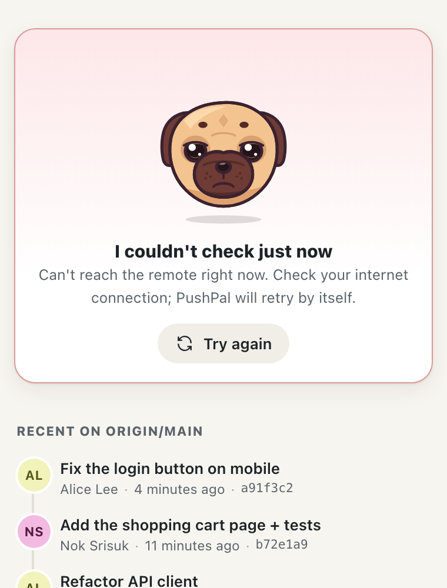
</picture>
</td>
<td valign="top">

**What it means:** Git reported a problem — no internet, not signed in to the remote, another git command
running… PushPug says which in plain words and how to fix it.

**What to do:** follow the hint, then press **Try again**. *Show full message* shows Git's original text.

</td>
</tr>

<tr><td colspan="2"><h3>This branch isn't on GitHub yet</h3></td></tr>
<tr>
<td valign="top">
<picture>
  <source media="(prefers-color-scheme: dark)" srcset="docs/screenshots/en/team-noUpstream-dark.png">
  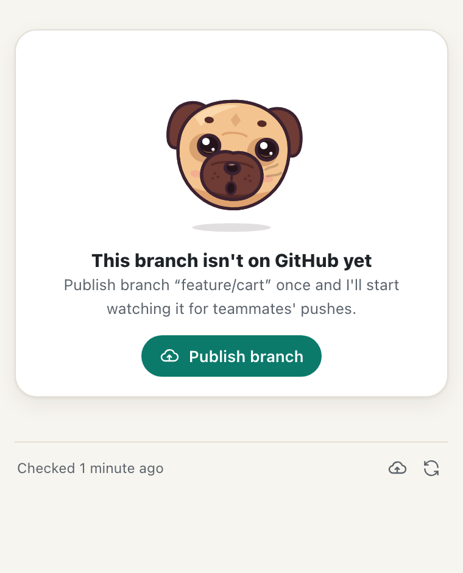
</picture>
</td>
<td valign="top">

**What it means:** your branch only exists on your computer, so there's nothing to watch yet.

**What to do:** press **Publish branch** once. PushPug starts watching it right away.

</td>
</tr>

<tr><td colspan="2"><h3>No project open</h3></td></tr>
<tr>
<td valign="top">
<picture>
  <source media="(prefers-color-scheme: dark)" srcset="docs/screenshots/en/team-noRepo-dark.png">
  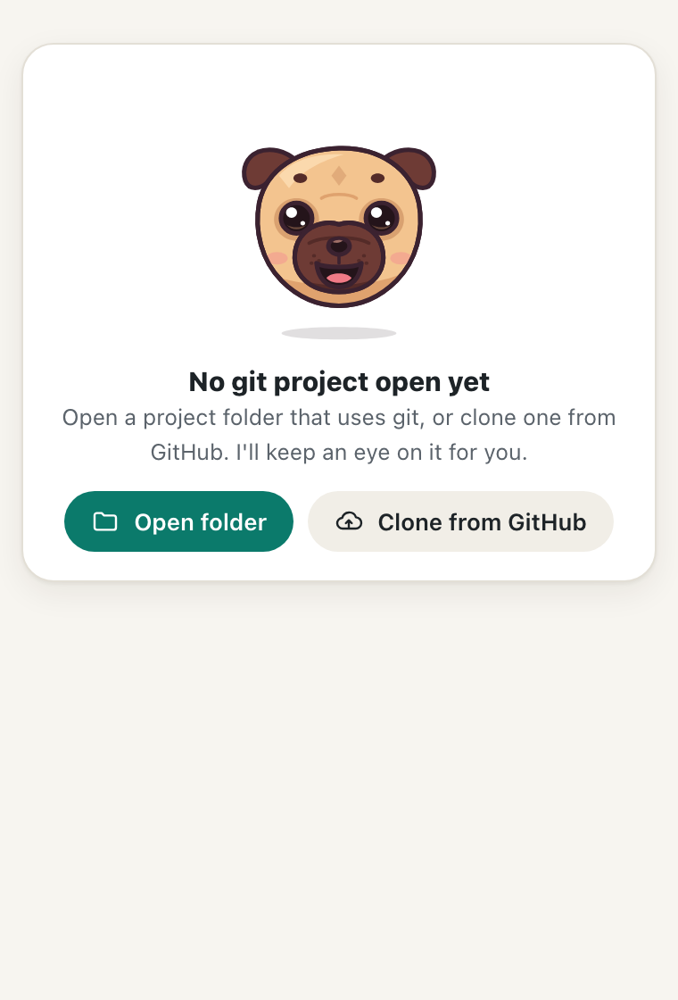
</picture>
</td>
<td valign="top">

**What it means:** the open folder isn't a git repository.

**What to do:** press **Open folder** for a project that uses git, or **Clone from GitHub**.

</td>
</tr>

<tr><td colspan="2"><h3>Your push was turned away</h3></td></tr>
<tr>
<td valign="top" align="center">

</td>
<td valign="top">

**What it means:** someone pushed before you, so Git refuses your push until you have their commits.

**What to do:** press **Merge, then push for me** — PushPug pulls their code in and pushes yours. To avoid it
altogether, push with **PushPug: Push (Check First)** (also in the Source Control title bar), which checks the
remote before pushing. VS Code's own **Push** / **Sync** get the same help when they're rejected.

</td>
</tr>
<tr><td colspan="2"><h3>Working with pull requests</h3></td></tr>
<tr>
<td valign="top">
<picture>
  <source media="(prefers-color-scheme: dark)" srcset="docs/screenshots/en/team-prOpen-dark.png">
  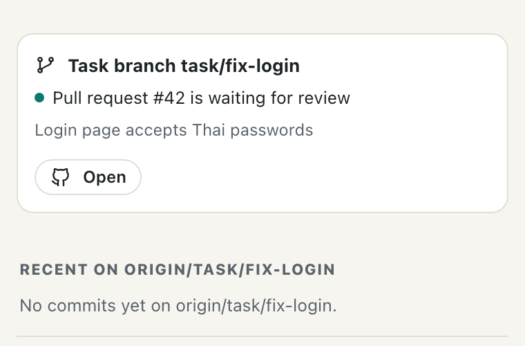
</picture>
</td>
<td valign="top">

**What it means:** many teams don't push to `main` directly. Each task gets its own branch, and the work goes
into `main` through a pull request that the team can look at first. That way two people's work doesn't collide
on `main`.

**What to do:**
1. Run **PushPug: Start New Task** (also in the Source Control `…` menu, or the button in My Team) and type
   a few words about the task. PushPug makes a branch from the latest `main`; uncommitted work comes along.
2. Work and commit as usual.
3. Press **Send for review**. PushPug pushes the branch and opens the pull request on GitHub (using VS Code's
   GitHub sign-in). Pressing it again later sends your new commits to the same pull request.

PushPug also tells you when a teammate opens a pull request.

</td>
</tr>

<tr><td colspan="2"><h3>Committed on main by mistake</h3></td></tr>
<tr>
<td valign="top">
<picture>
  <source media="(prefers-color-scheme: dark)" srcset="docs/screenshots/en/team-prUnsent-dark.png">
  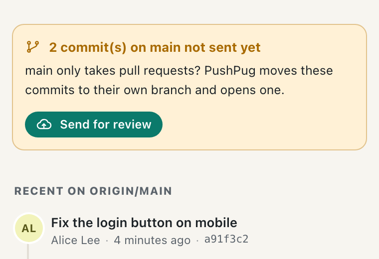
</picture>
</td>
<td valign="top">

**What it means:** you have commits on `main` that aren't pushed. If `main` only accepts pull requests,
pushing them is refused (GitHub says *"Changes must be made through a pull request"*).

**What to do:** press **Send for review** (or **Send for review instead** on the push error). PushPug moves
the commits to a new branch, puts your `main` back in line with the team's, and opens the pull request.
Nothing is lost.

</td>
</tr>

<tr><td colspan="2"><h3>Your pull request conflicts with main</h3></td></tr>
<tr>
<td valign="top">
<picture>
  <source media="(prefers-color-scheme: dark)" srcset="docs/screenshots/en/team-prConflict-dark.png">
  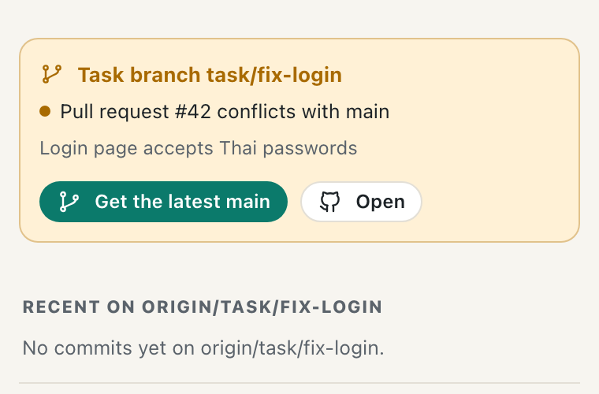
</picture>
</td>
<td valign="top">

**What it means:** someone changed the same lines on `main` after you started.

**What to do:** press **Get the latest main**. PushPug merges `main` into your branch; fix any conflicts the
usual way, then **Send new commits** and the pull request is fixed.

</td>
</tr>

<tr><td colspan="2"><h3>Your pull request was merged</h3></td></tr>
<tr>
<td valign="top">
<picture>
  <source media="(prefers-color-scheme: dark)" srcset="docs/screenshots/en/team-prMerged-dark.png">
  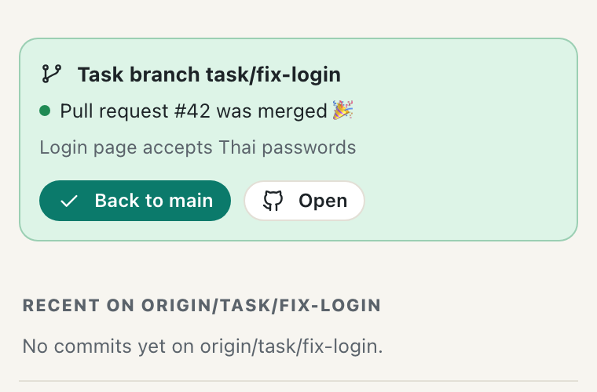
</picture>
</td>
<td valign="top">

**What it means:** your work is in `main`. 🎉

**What to do:** press **Back to main**. PushPug switches to `main`, pulls the latest code, and deletes the
finished branch (only if every commit on it is merged, so nothing gets lost). Then start your next task.

</td>
</tr>

</table>

---

## Settings

Everything is in **PushPug Settings** (gear icon in **My Team**, or **PushPug: Open Settings**) and mirrored in
VS Code's Settings — change either, the other follows instantly.

### How often PushPug checks

| Mode | Checks | Good for |
|---|---|---|
| Fastest | every 10 s | teams pushing all day |
| Balanced *(default)* | every 30 s | most people |
| Battery saver | every 60 s, slower when idle or on battery | laptops on the go |
| Custom | your values | full control |

Each mode shows what it costs, e.g. *120 checks/hour · ≈ 655 KB/hour*, based on measured `git fetch` sizes.
Switch quickly with **PushPug: Switch Check Mode**.

### Not being disturbed

Set **do-not-disturb hours** (e.g. 22:00–08:00) or press **Mute 1 hour** on any alert. No pop-ups or desktop
notifications meanwhile; the status bar keeps updating and anything you missed is announced afterwards.

<p align="center">
  <picture>
    <source media="(prefers-color-scheme: dark)" srcset="docs/screenshots/en/settings-frequency-dark.png">
    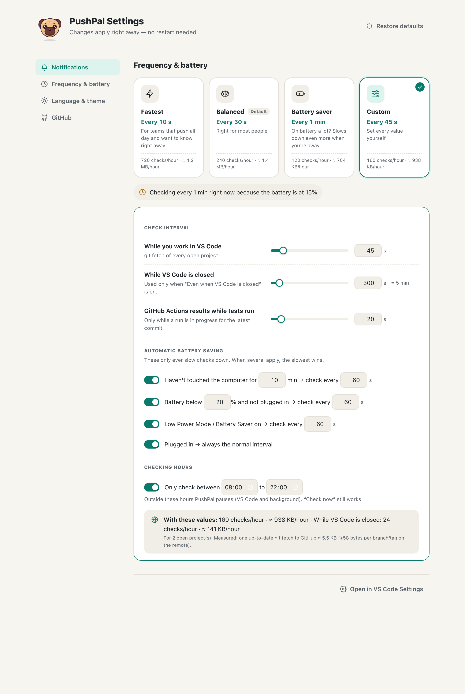
  </picture>
  <picture>
    <source media="(prefers-color-scheme: dark)" srcset="docs/screenshots/en/settings-notify-dark.png">
    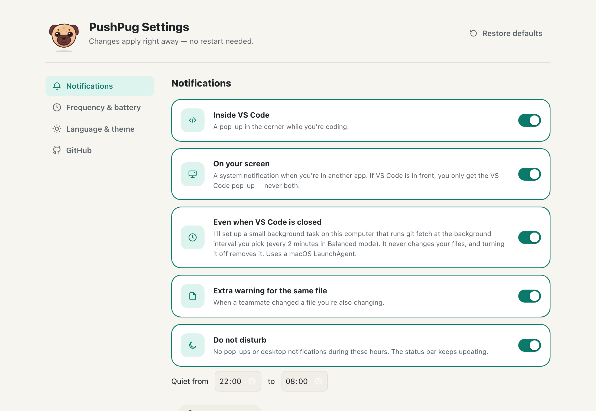
  </picture>
</p>

### All settings

| Setting | Default | |
|---|---|---|
| `pushpug.mode` | `balanced` | `fast`, `balanced`, `batterySaver`, `custom` |
| `pushpug.checkIntervalSeconds` | `30` | while VS Code is open (10–300) |
| `pushpug.background.intervalSeconds` | `120` | while VS Code is closed (60–3600) |
| `pushpug.battery.*` | on | idle / low battery / Low Power Mode slow-downs; plugged in = normal |
| `pushpug.activeHours.*` | off | only check between two times |
| `pushpug.notify.inVSCode` / `.desktop` | on | where alerts appear |
| `pushpug.notify.background` | off | alerts while VS Code is closed (macOS, Windows) |
| `pushpug.notify.sameFileWarning` | on | extra warning for files you're also editing |
| `pushpug.quiet.enabled` / `.start` / `.end` | off · 22:00–08:00 | do-not-disturb hours |
| `pushpug.actions.enabled` | on | GitHub test results |
| `pushpug.actions.notifyOnPass` | on | also tell me when tests pass |
| `pushpug.actions.notifyFor` | `all` | `all`, `mine`, `team` |
| `pushpug.avatars` | on | commit authors' GitHub profile pictures |
| `pushpug.pullRequests.enabled` | on | Start New Task / Send for Review, pull request alerts |
| `pushpug.pullRequests.notifyTeam` | on | tell me when a teammate opens a pull request |
| `pushpug.language` / `pushpug.theme` | auto · system | Thai or English; light, dark or match VS Code |

## Privacy

- **No telemetry.** Nothing about you or your code is collected.
- Your normal `git fetch` / `pull` / `push` go to your own remote.
- For **github.com** projects only, and only if enabled: test results, profile pictures and pull requests
  go through GitHub's API with **VS Code's built-in GitHub sign-in**. PushPug never asks you to paste a token and never
  saves one. While tests are running it asks every 20–30 s, stops when they're done, and slows down by itself
  near GitHub's rate limit.
- The optional background task only runs `git fetch` (and `gh api` for test results if you use the GitHub
  CLI). It never pulls or changes your files.

## Troubleshooting

<details>
<summary><b>I don't get desktop notifications</b></summary>
<br>

Send a test from the wizard (**PushPug: Run Setup Again** → *Test*). Then check your system's notification
settings ([D. macOS](#d-macos-setup), [E. Windows](#e-windows-setup) or [F. Linux](#f-linux-setup)), and PushPug's own **do-not-disturb hours** and **Mute 1 hour**.

</details>

<details>
<summary><b>“Couldn't sign in to the remote”</b></summary>
<br>

PushPug uses the same git as your terminal. Press **Sync** once in Source Control to sign in, then PushPug can
check again. It never asks for passwords itself.

</details>

<details>
<summary><b>No test results show up</b></summary>
<br>

They appear for github.com projects that have checks (e.g. GitHub Actions), after you've signed in under
**PushPug Settings → GitHub**. If you chose *No thanks* earlier, turn **GitHub test results** back on there.

</details>

<details>
<summary><b>Pug doesn't move after an update</b></summary>
<br>

Run **Developer: Reload Window** once — open panels keep the old version until they're reloaded.

</details>

---

## Development

```bash
npm install
npm test            # real git repos (bare remote + two clones) and a mocked GitHub API
npm run build
npm run smoke       # runs the extension in your local VS Code with an isolated profile (macOS)
npm run screenshots # renders every screen into docs/screenshots/
node scripts/guide-illustrations.mjs # draws the installation guide pictures into docs/guide/
npm run package     # builds pushpug-<version>.vsix
node scripts/mascot-render.mjs stills # Pug's faces for this README (docs/mascot/still/)
```

Design decisions: [DECISIONS.md](DECISIONS.md) · Publishing: [PUBLISHING.md](PUBLISHING.md) ·
Releasing: `npm run release` (bumps the version and pushes a tag; CI tests, packages and publishes).

## License

[MIT](LICENSE) · Pug, the mascot, is an original drawing made for PushPug.
